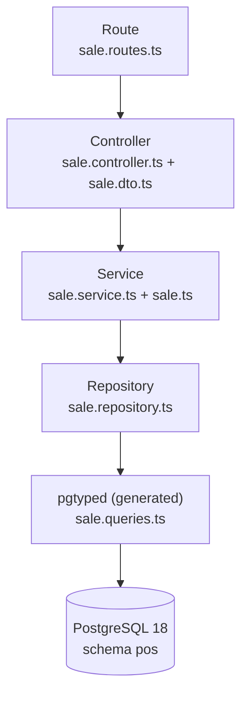
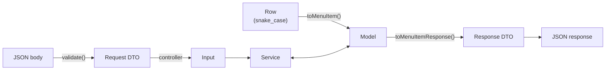
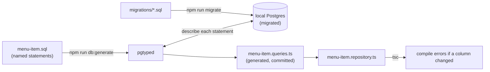
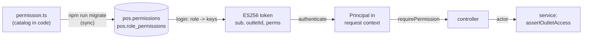
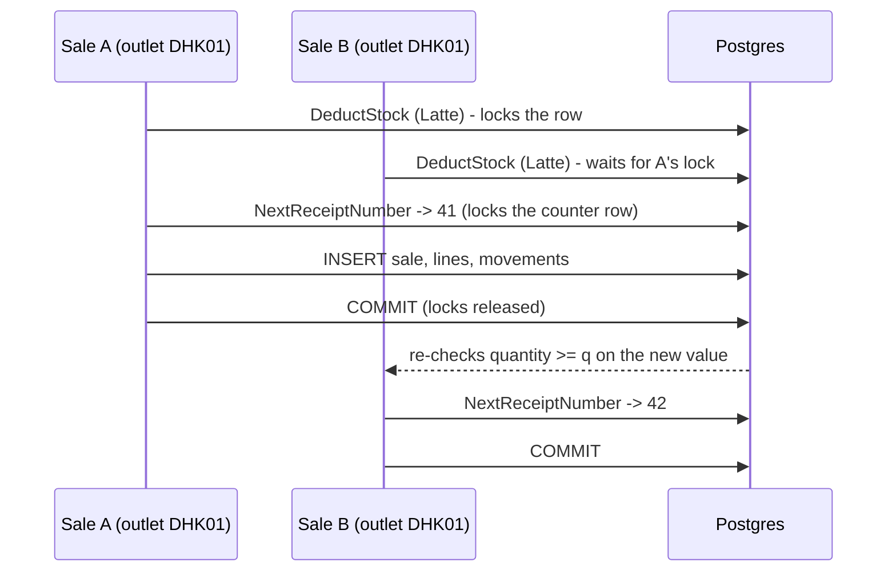

# POS System - Backend Design Patterns (Node.js + TypeScript)

| Field | Value |
|---|---|
| Status | target design, 2026-11-25; each feature's spec confirms or changes its part |
| Applies to | `api/` (Node.js 26, Express 5, TypeScript, PostgreSQL 18, `pg` + pgtyped) |
| Short version | `.claude/rules/backend.md`, `.claude/rules/database.md` (pgtyped and repositories), `.claude/rules/sales.md` (the sale transaction) |
| Explained visually in | `docs/backend-guide.html` |
| Related | `docs/database-design.md` (schema), `docs/frontend-engineering.md` (how the web app reads problem responses), `docs/infrastructure.md` (containers, environment, deploy) |

These are the rules every line of the API follows.
Nothing is built yet: this is the target, and the first feature that touches a section confirms or changes it here, in the same change.
Claude follows these rules when writing code, and reviewers check them.
The `.claude/rules/` files are the short version of this document and must always agree with it.

Anything marked **(proposed)** is a decision this document adds beyond the brief and the rules files.
It stands until the spec that builds that part accepts or changes it.

Words used throughout:

- **HQ** (headquarters) users have no outlet; they manage the master menu, outlets, users and roles, and read every outlet's reports.
- **Outlet** users belong to exactly one outlet and work only on that outlet's menu, stock and sales.
- **DTO** (data transfer object) is the shape of JSON on the wire.
- **Use case** is a service method a controller calls; it owns the database transaction.
- **Step** is a service method that takes a transaction and joins it.

---

## 1. Layers

Four hand-written layers and one generated layer.
Dependencies point down only.



| Layer | Files | Job | May use | Must never |
|---|---|---|---|---|
| Route | `<thing>.routes.ts` | Map a method and path to its middleware and one controller method | the controller, `auth.authenticate`, `requirePermission`, `methodNotAllowed` | hold any logic |
| Controller | `<thing>.controller.ts`, `<thing>.dto.ts` | Parse and validate input, call one use case, map the model to a response DTO, `respond()` | `validate`, `respond`, `currentPrincipal`, its own service, DTO mappers | run SQL, make business decisions, write an error body, log |
| Service | `<thing>.service.ts`, `<thing>.ts` | Business rules, the outlet scope check, the transaction boundary | models, its repositories, other modules' services (through `dependencies.ts`), `withTx`, `AppError` constructors, clock and ID generator | import Express, know status codes or JSON, see pgtyped row types |
| Repository | `<thing>.repository.ts` | Run pgtyped queries, map rows to models, map database errors | the generated `<thing>.queries.ts`, `Db` and `Tx` types, `mapPgError`, models | make business decisions, open transactions, know HTTP |
| pgtyped (generated) | `<thing>.queries.ts` | One typed function per SQL statement | `pg` | be edited by hand |

Import rules:

- A module reaches another module only through its service, typed by a small interface in its own `dependencies.ts`.
  Type-only imports of another module's models (`import type { MenuItem } from '../menu/menu-item'`) are allowed.
- `src/platform/*` never imports from `src/modules/*`.
- Only route, controller and platform files import `express`.
- Only repositories import `*.queries.ts`.
- Only `src/platform/config`, `src/main.ts` and the `src/cli/` entry files (`cli/migrate.ts`, later `cli/seed.ts`) read `process.env`; a CLI entry is a program start, like `main.ts`.
- These rules are enforced by ESLint `no-restricted-imports` zones in `api/eslint.config.js`, so a wrong import fails lint, not review **(proposed)**.
  Today the one zone is "platform never imports a module"; the others arrive with the first modules.

## 2. The `api/` folder

```
api/
  package.json              scripts: dev, build, lint, typecheck, test, migrate, seed, db:generate
  tsconfig.json             strict, noUncheckedIndexedAccess, exactOptionalPropertyTypes
  pgtyped.config.json       one transform: every src/**/*.sql -> <name>.queries.ts next to it
  vitest.config.ts          unit and integration tests from test/; database tests start Postgres with testcontainers
  migrations/               numbered SQL (a .ts file only for a no-transaction migration), never edited once applied
  test/                     mirrors src/: test/platform/db/with-tx.test.ts tests src/platform/db/with-tx.ts; support/ holds shared helpers
  src/
    main.ts                 run: loadSettings -> logger -> pool -> buildApp -> serveUntilStopped
    app.ts                  buildApp: express() -> platform stack -> mountRoutes -> static web + SPA fallback -> notFoundHandler -> errorHandler
    services.ts             buildServices: construct every repository and service once, wire dependencies
    routes.ts               mountRoutes: one line per module
    platform/
      clock.ts              Clock, systemClock (no caller until the first module needs the time)
      ids.ts                IdGenerator, uuidV7Ids
      process.ts            serveUntilStopped, startServer, stopServer, installProcessHandlers
      has-property.ts       hasProperty: narrows unknown to an object with a given key
      config/               loadBase, loadDatabase, loadHttp, loadTokenSettings; Secret
      logger/               createLogger (pino JSON to stdout), request context (AsyncLocalStorage), logger()
      errors/               AppError, kinds, constructors, kindOf, isError, withTitle
        to-app-error.ts     toAppError: any thrown value -> AppError (body-parser errors become validation)
      http/                 requestId, securityHeaders, requestLog, jsonBody, errorHandler (writeProblem), validate, respond, methodNotAllowed
        route-pattern.ts    recordRoutePrefix, routeOf, allowedMethods: the matched route pattern for logs and 405s
        serve-web.ts        serveWeb: the built React app, cache headers, the SPA fallback
        not-found-handler.ts  notFoundHandler: unmatched path -> 404 problem
      db/                   createPool, withTx, mapPgError, Db / Tx types
        loggable-error.ts   databaseErrorLog, loggableError: a Postgres error reduced to codes and names for the log
      auth/                 token signer (ES256), authenticate, requirePermission, Principal, assertOutletAccess
      health/               GET /healthz, GET /readyz (outside /api)
    modules/
      auth/                 login, logout, me
      roles/                roles, the permission catalog (permission.ts), the permission sync
      users/
      outlets/
      menu/                 master menu items and outlet assignments (prices, availability)
      inventory/            stock per outlet and stock movements
      sales/                the sale transaction, receipt numbers, sales lists
      reports/              revenue by outlet, top items
    cli/
      migrate.ts            entry: loadMigrateSettings -> runMigrations -> exit code
      run-migrations.ts     apply migrations with node-pg-migrate, then sync the permission catalog (as the migrator role)
      seed.ts               demo data: HQ admin, outlets, menu, assignments, stock, outlet users
```

A module is one folder named after the area.
Inside it, every file starts with the area's thing and ends with its job:

| File | Job |
|---|---|
| `<thing>.ts` | model types, `as const` enums, area errors built from `AppError` constructors, input types and pure rules |
| `<thing>.dto.ts` | zod request schemas (`.strict()`), response types, `toXResponse` mappers |
| `<thing>.routes.ts` | `register<Thing>Routes(router, controller, auth)`: path, middleware, controller method |
| `<thing>.controller.ts` | parse and validate input, call one service use case, map to a response DTO, `respond()` |
| `<thing>.service.ts` | business rules and the transaction boundary |
| `<thing>.repository.ts` | calls pgtyped queries, maps rows to models, maps database errors |
| `<thing>.sql` | the SQL for this thing, one named statement after another |
| `<thing>.queries.ts` | generated by pgtyped from `<thing>.sql`; committed; never edited |
| `dependencies.ts` | the small interfaces the service needs, named after the real thing |
| `<thing>.test.ts` | lives in `api/test/modules/<area>/`, mirroring this folder, never in the module folder itself |

A module may hold more than one thing: `menu/` has `menu-item.*` (the master menu) and `outlet-menu.*` (assignments).
When a file grows past about 400 lines and has a clear seam, move that part into `<thing>-<part>.ts` (for example `sale-lines.ts` for line normalising and pricing) **(proposed)**.
Never create `utils/`, `helpers/`, `common/` or `shared/` folders; code that two modules need belongs to one of them (reached through its service) or to `platform/`.

### Wiring

`main.ts` (and each CLI entry file) is the only place that reads the environment, and `services.ts` the only place that calls `new` on a service or repository.

```ts
// src/main.ts
async function main(): Promise<void> {
  const settings = loadSettings(process.env);
  const logger = createLogger(settings.base);
  installProcessHandlers(logger);
  logger.info({ settings }, 'config loaded');
  const pool = createPool(settings.database);
  const services = buildServices(pool, { clock: systemClock, ids: uuidV7Ids, tokenSigner: createTokenSigner(settings.token) });
  const app = buildApp(services);
  await serveUntilStopped(app, settings.http, pool);
}
```

```ts
// src/app.ts
export function buildApp(services: Services): Express {
  const app = express();
  app.disable('x-powered-by');
  app.set('trust proxy', 1);
  app.use(requestId);
  app.use(securityHeaders);
  app.use(requestLog);
  app.use(jsonBody);
  registerHealthRoutes(app, services.pool);
  app.use('/api/v1', mountRoutes(services, services.auth));
  app.use('/api', notFoundHandler);
  serveWeb(app, WEB_BUILD_DIR);
  app.use(notFoundHandler);
  app.use(errorHandler);
  return app;
}
```

- `trust proxy` is set to one hop (Caddy), so `req.protocol` and `req.ip` reflect the browser, not the proxy **(proposed)**.
- `app.use('/api', notFoundHandler)` sits before the web fallback, so a mistyped API path answers a 404 problem, never `index.html`.
- `serveWeb` serves the built React app from `api/public` (hashed assets `Cache-Control: public, max-age=31536000, immutable`, `index.html` `no-cache`) and answers any other `GET` that accepts HTML with `index.html`, so client routes like `/hq/menu` survive a reload.
- `serveUntilStopped` listens on `HTTP_PORT`; on `SIGTERM` or `SIGINT` it stops accepting connections, waits up to `SHUTDOWN_TIMEOUT` for in-flight requests, closes what is left, then ends the pool.

```ts
// src/routes.ts
export function mountRoutes(services: Services, auth: Auth): Router {
  const router = express.Router();
  registerAuthRoutes(router, new AuthController(services.authService), auth);
  registerRoleRoutes(router, new RoleController(services.roleService), auth);
  registerUserRoutes(router, new UserController(services.userService), auth);
  registerOutletRoutes(router, new OutletController(services.outletService), auth);
  registerMenuRoutes(router, new MenuController(services.menuItemService, services.outletMenuService), auth);
  registerInventoryRoutes(router, new InventoryController(services.inventoryService), auth);
  registerSaleRoutes(router, new SaleController(services.saleService), auth);
  registerReportRoutes(router, new ReportController(services.reportService), auth);
  return router;
}
```

`mountRoutes` is the table of contents of the API: one line per module.

The code above is the target once modules exist.
Today there are none, so the built shape is smaller:

- `buildServices(pool)` returns `{ pool }`; the clock, the ID generator and the token signer are wired in with the first module that needs them.
- `mountRoutes()` takes no arguments and returns an empty router, mounted as `app.use('/api/v1', recordRoutePrefix, mountRoutes())`; `recordRoutePrefix` stores the mount prefix for the request line's `route`.
- `main.ts` also calls `setRootLogger(logger)`, so `logger()` outside a request uses the configured logger.
- `buildApp(services, { webDir })` takes the web build folder as an option, so tests can point it at a fixture; it defaults to `public/` beside `dist/`.

## 3. Four shapes of data

| Shape | Lives in | Written by | Keys | Purpose |
|---|---|---|---|---|
| Request DTO | `<thing>.dto.ts` | hand (zod schema; type inferred with `z.infer`) | camelCase | what a client may send |
| Model | `<thing>.ts` | hand | camelCase | the business object the service works with |
| Row | `<thing>.queries.ts` | pgtyped | snake_case, exactly as the query returns | what Postgres gives back |
| Response DTO | `<thing>.dto.ts` | hand | camelCase | what the API promises to return |

Data changes shape in exactly two places:

1. **Repository:** row to model (`toMenuItem(row)`), and model to query parameters.
2. **Controller:** request DTO to the use case's input, and model to response DTO (`toMenuItemResponse(menuItem)`).



Rules:

- Every entity has a model, even a simple one; the model is the buffer that keeps a schema change inside the repository.
- Never return a row or a model as JSON, and never reuse a request DTO as a response.
- Mappers list every field by hand.
  Never spread a model into a DTO (`{ ...user }`): the user model holds `passwordHash`, and a spread is one forgotten line away from sending it.
- One response DTO per distinct API shape; a list item may be slimmer than the detail (`SaleSummaryResponse` and `SaleResponse`).
- Read models are allowed for reports and list screens (`RevenueByOutlet`, `OutletMenuEntry`), each built by its own query, and each still a model.
- In models: money is `number` in minor units (`basePriceMinor`), IDs are `string`, times are `Date`.
  In DTOs: money is the same integer, IDs are strings, times are ISO 8601 strings in UTC (`createdAt.toISOString()`).
- Rows keep the database's snake_case names: pgtyped's `camelCaseColumnNames` is off, so a row can never pass for a model or a DTO by accident **(proposed)**.
- Enums are `as const` objects with a derived union, never TypeScript `enum`:

```ts
// inventory.ts
export const StockMovementReason = {
  Sale: 'sale',
  Restock: 'restock',
  Adjustment: 'adjustment',
} as const;
export type StockMovementReason = (typeof StockMovementReason)[keyof typeof StockMovementReason];
```

The menu item, in all four shapes:

```ts
// menu-item.dto.ts
export const createMenuItemRequest = z
  .object({
    sku: z.string().trim().min(1).max(40),
    name: z.string().trim().min(1).max(120),
    description: z.string().trim().max(1000).nullable().default(null),
    category: z.string().trim().min(1).max(60).nullable().default(null),
    basePriceMinor: z.number().int().min(0).max(MAX_PRICE_MINOR),
  })
  .strict();
export type CreateMenuItemRequest = z.infer<typeof createMenuItemRequest>;

export type MenuItemResponse = {
  id: string;
  sku: string;
  name: string;
  description: string | null;
  category: string | null;
  basePriceMinor: number;
  isActive: boolean;
  updatedAt: string;
};

export function toMenuItemResponse(menuItem: MenuItem): MenuItemResponse {
  return {
    id: menuItem.id,
    sku: menuItem.sku,
    name: menuItem.name,
    description: menuItem.description,
    category: menuItem.category,
    basePriceMinor: menuItem.basePriceMinor,
    isActive: menuItem.isActive,
    updatedAt: menuItem.updatedAt.toISOString(),
  };
}
```

```ts
// menu-item.ts
export type MenuItem = {
  id: string;
  sku: string;
  name: string;
  description: string | null;
  category: string | null;
  basePriceMinor: number;
  isActive: boolean;
  createdAt: Date;
  updatedAt: Date;
};

export type CreateMenuItemInput = Pick<MenuItem, 'sku' | 'name' | 'description' | 'category' | 'basePriceMinor'>;

export const ErrMenuItemNotFound = notFound('Menu item not found');
export const ErrSkuTaken = conflict('A menu item with this SKU already exists');
```

SKU means stock keeping unit, the short code HQ gives each menu item.

## 4. pgtyped: you write SQL, it writes the TypeScript

pgtyped is a code generator, not an ORM (object-relational mapper).
We write plain SQL; pgtyped asks a real, migrated Postgres to describe every statement and writes a typed function for it.
Postgres itself checks every table, column, parameter and result type, so a query that does not match the schema fails at generation time, and a schema change surfaces as TypeScript compile errors in the repositories that read the changed columns.

### How it works



1. Write the statement in the module's `<thing>.sql`, with a name:

   ```sql
   /* @name GetMenuItem */
   SELECT id, sku, name, description, category, base_price_minor, is_active, created_at, updated_at
     FROM pos.menu_items
    WHERE id = :id!;

   /* @name InsertMenuItem */
   INSERT INTO pos.menu_items (id, sku, name, description, category, base_price_minor, is_active)
   VALUES (:id!, :sku!, :name!, :description, :category, :basePriceMinor!, :isActive!)
   RETURNING id, sku, name, description, category, base_price_minor, is_active, created_at, updated_at;
   ```

2. Run `npm run migrate` (if a migration changed), then `npm run db:generate`.
3. pgtyped writes `menu-item.queries.ts` next to the SQL, with `IGetMenuItemParams`, `IGetMenuItemResult` and a `getMenuItem` query object.
4. The repository runs it: `await getMenuItem.run({ id }, db)`, which returns `IGetMenuItemResult[]`.
5. `npm run typecheck` shows every place that used a column that changed.

### Configuration

```json
{
  "transforms": [
    { "mode": "sql", "include": "**/*.sql", "emitTemplate": "{{dir}}/{{name}}.queries.ts" }
  ],
  "srcDir": "./src",
  "failOnError": true,
  "camelCaseColumnNames": false,
  "typesOverrides": { "int8": "number" }
}
```

- `db:generate` points pgtyped at the local database through the environment; no connection string is committed.
- `int8` (Postgres `bigint`) is typed as `number`, because money is `bigint` minor units and `number` in TypeScript.
  `createPool` installs the matching runtime parser for `bigint` that throws if a value is ever above `Number.MAX_SAFE_INTEGER` (9,007,199,254,740,991), so a silent precision loss is impossible.
  The parser is set on the pool (`types`), not globally with `setTypeParser`.
  It covers `int8` only: an `int8[]` column still arrives as strings, so the first query that returns one adds an array parser.
- `timestamptz` arrives as `Date`, `uuid` as `string`, `boolean` as `boolean`, nullable columns as `T | null`.

### Writing SQL for pgtyped

- SQL lives only in `<thing>.sql` files; the one exception is infrastructure SQL inside `src/platform/db` (`BEGIN`, `COMMIT`, `ROLLBACK`, `SELECT 1`).
- Statement names are `VerbNoun` and say what they do: `GetMenuItem`, `ListOutletMenu`, `PriceItemsForSale`, `DeductStock`, `NextReceiptNumber`, `InsertSaleItems`.
- Tables are always qualified with the schema: `pos.menu_items`.
- Columns are listed explicitly; no `SELECT *` or `RETURNING *`, so a new column never reaches a row by surprise and each statement says what it reads **(proposed)**.
- Parameters that must be present end in `!` (`:outletId!`); a parameter without `!` may be `null`.
- A result column that Postgres reports as nullable but is never null gets a not-null hint in its alias: `SELECT count(*) AS "saleCount!"`.
- `SUM` over a `bigint` column returns `numeric`, which `pg` hands over as a string: always cast it back, `SUM(total_minor)::bigint AS "revenueMinor!"`.
- A list of IDs is one array parameter, `WHERE menu_item_id = ANY(:menuItemIds!::uuid[])`, so the statement text is the same whatever the list length.
- Several rows in one insert use pgtyped's spread syntax:

  ```sql
  /*
    @name InsertSaleItems
    @param items -> ((saleId!, lineNo!, outletId!, menuItemId!, itemName!, unitPriceMinor!, quantity!, lineTotalMinor!)...)
  */
  INSERT INTO pos.sale_items (sale_id, line_no, outlet_id, menu_item_id, item_name, unit_price_minor, quantity, line_total_minor)
  VALUES :items;
  ```

- Conditional updates use `RETURNING`, so the repository can tell "0 rows changed" from success (see `DeductStock` in section 11).

### Generated files and the drift check

- `*.queries.ts` files are committed, so a reviewer sees the typed shape of every statement in the pull request, and the app builds without a database.
- They are never edited by hand; ESLint and Prettier ignore them.
- After any migration: `npm run migrate`, then `npm run db:generate`, then fix every compile error it causes, in the same change.
- CI (continuous integration) checks for drift in `ci.yml`: a `postgres:18.7-alpine` service container exists only for this check, and the roles script runs inside it first; CI runs `npm run migrate` and `npm run db:generate` against it, then fail if `git status --porcelain -- 'src/**/*.queries.ts'` shows any change or a new file, or if a `*.queries.ts` has no `.sql` file beside it.
  The failure message tells the author to run the two commands locally and commit the result.

What pgtyped does not catch: wrong logic in a `WHERE`, a missing index, or a statement that is correct but slow.
Integration tests against real Postgres cover the first; `docs/database-design.md` covers the other two.

## 5. Repository

A repository is a class with no state: it never holds a connection, a pool or a transaction.
Each method does one database thing, takes the connection as its first argument, and returns models.

```ts
// menu-item.repository.ts
type MenuItemRow = IGetMenuItemResult;

export class MenuItemRepository {
  async getMenuItem(db: Db, id: string): Promise<MenuItem | null> {
    try {
      const [row] = await getMenuItem.run({ id }, db);
      return row ? toMenuItem(row) : null;
    } catch (err) {
      throw mapPgError(err);
    }
  }

  async insertMenuItem(db: Db, menuItem: NewMenuItem): Promise<MenuItem> {
    try {
      const rows = await insertMenuItem.run(
        {
          id: menuItem.id,
          sku: menuItem.sku,
          name: menuItem.name,
          description: menuItem.description,
          category: menuItem.category,
          basePriceMinor: menuItem.basePriceMinor,
          isActive: menuItem.isActive,
        },
        db,
      );
      return toMenuItem(exactlyOne(rows, 'InsertMenuItem'));
    } catch (err) {
      if (isUniqueViolation(err, 'menu_items_sku_key')) throw ErrSkuTaken;
      throw mapPgError(err);
    }
  }
}

function toMenuItem(row: MenuItemRow): MenuItem {
  return {
    id: row.id,
    sku: row.sku,
    name: row.name,
    description: row.description,
    category: row.category,
    basePriceMinor: row.base_price_minor,
    isActive: row.is_active,
    createdAt: row.created_at,
    updatedAt: row.updated_at,
  };
}
```

- The first argument is `db: Db` (the pool or a transaction, the caller chooses) or `tx: Tx` when the statement only makes sense inside a transaction, such as a locking update (`deductStock(tx, ...)`, `nextReceiptNumber(tx, ...)`) **(proposed)**.
  The type system then refuses a locking write on the bare pool.
- Methods are named exactly like the pgtyped statement they run: `GetMenuItem` becomes `getMenuItem`.
- Single reads return `null` for "not found"; the service decides whether that is an error.
  Lists return `[]`.
- Every row is mapped to a model by a hand-written `toX(row)` next to the repository.
  Statements that return the same columns produce structurally identical result types, so one `toX` serves them all.
- Every database error leaves through `mapPgError` (section 10); no Postgres error code is ever checked above the repository.
- A constraint with a business meaning is translated by name into the area's error before `mapPgError`: `menu_items_sku_key` becomes `ErrSkuTaken`, `sales_outlet_id_idempotency_key_key` becomes `ErrDuplicateIdempotencyKey`.
  The constraint names are schema detail, so they stay in the repository.
- A delete blocked by `ON DELETE RESTRICT` ("still referenced") fails with `23001` (restrict violation), not `23503`; `mapPgError` makes it a `conflict` (409), and the repository may first translate it into a named area error, such as `ErrRoleInUse` or the error for unassigning an item that has sales.
- `exactlyOne(rows, statementName)` (in `platform/db`) returns the single row of an `INSERT ... RETURNING` and throws an unexpected error naming the statement if there is not exactly one **(proposed)**.
- No business decisions: no "if the item is inactive, skip it".

## 6. Service

The service holds the business rules and decides the transaction boundary.

```ts
// sales/dependencies.ts
export interface MenuService {
  priceItemsForSale(tx: Tx, outletId: string, menuItemIds: readonly string[]): Promise<SellableItem[]>;
}

export interface InventoryService {
  deductForSale(tx: Tx, outletId: string, lines: readonly SaleLine[]): Promise<void>;
  recordSaleMovements(tx: Tx, sale: Sale): Promise<void>;
}
```

```ts
// sale.service.ts
export class SaleService {
  constructor(
    private readonly db: Pool,
    private readonly saleRepository: SaleRepository,
    private readonly menuService: MenuService,
    private readonly inventoryService: InventoryService,
    private readonly ids: IdGenerator,
  ) {}

  async createSale(actor: Principal, outletId: string, input: CreateSaleInput): Promise<Sale> {
    assertOutletAccess(actor, outletId);
    const lines = normaliseLines(input.lines);
    try {
      return await withTx(this.db, (tx) => this.recordSale(tx, actor, outletId, lines, input.idempotencyKey));
    } catch (err) {
      if (input.idempotencyKey && isError(err, ErrDuplicateIdempotencyKey)) {
        const original = await this.saleRepository.getSaleByIdempotencyKey(this.db, outletId, input.idempotencyKey);
        if (original) return original;
      }
      throw err;
    }
  }
}
```

The full sale flow, `recordSale` included, is in section 11.

- **Dependencies arrive through the constructor**, wired once in `services.ts`; no module-level singletons, no service locator.
  The service receives the `Pool` (to open transactions), its own repositories, and small interfaces for everything else.
- **Small interfaces, declared by the user.** `dependencies.ts` lists only the methods this service calls, named after the real thing (`MenuService`, `InventoryService`, `PasswordHasher`, `TokenSigner`), and the constructor parameter uses the same name in camelCase.
  Tests can pass a fake for an outside service; another module's service is passed for real.
- **Who is acting** is an explicit argument, `actor: Principal`, passed by the controller.
  A service never reads the request context to find the user, so it runs the same from a CLI command or a test **(proposed)**.
- **The outlet scope check is the service's first line** in every use case that takes an `outletId`: `assertOutletAccess(actor, outletId)` (section 8).
- **Inputs are plain types** (`CreateSaleInput`), not DTOs; the controller converts.
- **Results are models** or area errors (`ErrInsufficientStock`), never rows, DTOs or status codes.
- **IDs and time** come from the injected `IdGenerator` and `Clock` (section 13).

### Use cases and steps

A service method's signature says which kind it is:

| Kind | Signature | Opens a transaction | Called by |
|---|---|---|---|
| Use case | no `tx` parameter: `createSale(actor, outletId, input)` | yes, with `withTx(this.db, async (tx) => ...)`, or none for a single read | controllers, CLI commands |
| Step | takes `tx` first: `deductForSale(tx, outletId, lines)` | never; it joins the caller's | use cases and other steps, in this or another module |

- A use case calls steps; a step may call other steps; a step never calls a use case, because that would start a second, separate transaction.
- When two use cases need the same logic, move it into one shared step (rules included) instead of copying it.
- A use case that runs exactly one statement passes `this.db` (the pool) and needs no transaction.
  Anything with two or more statements that must agree runs in one `withTx`.
- Cross-module work in one transaction calls the other module's step with the same `tx`: `createSale` calls `menuService.priceItemsForSale(tx, ...)` and `inventoryService.deductForSale(tx, ...)`.
- **No outside calls inside a transaction:** no HTTP, no token signing, no password hashing (argon2id takes tens of milliseconds of CPU), no waiting on anything outside Postgres.
  `createUser` hashes the password first, then opens the transaction.
- Unexpected errors are not wrapped for context: the stack trace and the `cause` chain already say where it failed.
  Wrap only to add an ID the log needs: ``new Error(`receipt counter missing for outlet ${outletId}`)``.

## 7. Controller and routes

### Controller

A controller is a class whose methods are arrow-function properties, so they can be handed to the router without `bind`.
Each method has the same five beats: read the principal, validate, call one use case, map, respond.

```ts
// sale.controller.ts
export class SaleController {
  constructor(private readonly saleService: SaleService) {}

  createSale = async (req: Request, res: Response): Promise<void> => {
    const { outletId } = validate(outletParams, req.params);
    const body = validate(createSaleRequest, req.body);
    const idempotencyKey = validate(idempotencyKeyHeader, req.get('Idempotency-Key') ?? null, 'Idempotency-Key');
    const sale = await this.saleService.createSale(currentPrincipal(), outletId, { lines: body.items, idempotencyKey });
    respond(res, 201, toSaleResponse(sale));
  };

  listSales = async (req: Request, res: Response): Promise<void> => {
    const { outletId } = validate(outletParams, req.params);
    const query = validate(listSalesQuery, req.query);
    const page = await this.saleService.listSales(currentPrincipal(), outletId, query);
    respond(res, 200, toSalePageResponse(page));
  };
}
```

```ts
// sale.dto.ts
export const outletParams = z.object({ outletId: z.uuid() }).strict();

export const createSaleRequest = z
  .object({
    items: z
      .array(z.object({ menuItemId: z.uuid(), quantity: z.number().int().min(1).max(999) }).strict())
      .min(1)
      .max(100),
  })
  .strict();

export const idempotencyKeyHeader = z.uuid().nullable();
```

- `validate(schema, value, root = 'body')` parses with zod and throws a `validation` error whose field keys are the JSON names (`items[1].quantity`, `menuItemId`); an error about the whole value is keyed by `root` (`body`, or the header name).
- Every body, query and path parameter goes through a zod schema before the controller uses it, and every object schema is `.strict()`: an unknown field is a 400.
- Limits on lists and numbers (100 lines a sale, quantity 1 to 999) are set in the DTO **(proposed)**.
- `currentPrincipal()` reads the `Principal` that `authenticate` put in the request context, and throws `ErrUnauthorized` if a route forgot `authenticate`, so the mistake is a 401, never a crash.
- `respond(res, status, body)` writes `application/json` with `Cache-Control: private, no-store`; `respond(res, 204)` sends no body.
- Controllers never log, never catch errors, and never write an error body: a thrown error travels to `errorHandler`.
- Express 5 detail: `req.query` is a getter and cannot be assigned; controllers read it into a new, validated object.

### Routes

```ts
// sale.routes.ts
export function registerSaleRoutes(router: Router, saleController: SaleController, auth: Auth): void {
  router
    .route('/outlets/:outletId/sales')
    .post(auth.authenticate, requirePermission(Permission.SalesCreate), saleController.createSale)
    .get(auth.authenticate, requirePermission(Permission.SalesRead), saleController.listSales)
    .all(methodNotAllowed);

  router
    .route('/outlets/:outletId/sales/:saleId')
    .get(auth.authenticate, requirePermission(Permission.SalesRead), saleController.getSale)
    .all(methodNotAllowed);
}
```

- Every path is registered once with `router.route(path)`, and its chain ends with `.all(methodNotAllowed)`, which throws a 405 carrying an `Allow` header built from the methods the route has **(proposed)**.
- `auth.authenticate` is named on each protected route; a public route (only `POST /auth/login`) simply omits it.
- `requirePermission(...keys)` comes right after it, with the keys from section 8.
- Paths use Express 5 syntax: `:name` parameters, `/*splat` for a named wildcard, no regular expressions.
- Business routes live under `/api/v1`; plural resources; outlet-owned data under `/api/v1/outlets/:outletId/...`.
- Health routes `/healthz` and `/readyz` sit outside `/api` (section 14).

## 8. Permissions and access control

### The pieces



- **Catalog in code.** Every permission key is defined once, in `api/src/modules/roles/permission.ts`.
  The `pos.permissions` table is only a copy, written by the migrate CLI and never edited by hand.
- **Token.** At login the API reads the user's one role and its keys and signs an ES256 JWT (JSON Web Token) with `jose`, carrying `sub` (user ID), `outletId` (or `null` for HQ users), `perms` (the keys), `iat` and `exp` (`ACCESS_TOKEN_TTL`, default 1 hour).
  There are no refresh tokens: when the token expires, the user signs in again.
- **Cookie.** Login sets the token in an HttpOnly cookie: `__Host-pos_at` when `PUBLIC_ORIGIN` is HTTPS (with `Secure`), `pos_at` locally over plain HTTP; `Path=/`, `SameSite=Lax`, `Max-Age` equal to the token lifetime.
  Other clients may send `Authorization: Bearer <token>` instead.
- **`authenticate`** (per route) reads `Authorization: Bearer` first and the cookie only if there is no header; a header that is present but malformed is a 401, never a fallback to the cookie.
  It verifies the signature locally with the public key and `algorithms: ['ES256']` (no database call), puts a `Principal` in the request context, and adds `userId` and `outletId` to the request's logger.
  A missing, expired or invalid token is a 401.
- **Origin check.** For `POST`, `PUT`, `PATCH` and `DELETE`, `authenticate` (and the public login route) refuse with 403 a request whose `Origin` header is present and is not the app's own origin **(proposed)**.
  `SameSite=Lax` stops other sites; this also stops a sibling subdomain, which counts as the same site.
- **`requirePermission(...keys)`** (per route) answers 401 if there is no principal and 403 unless the token holds at least one of the keys.
  It refuses to start (throws at startup) if called with no keys.
- **Outlet scope** is checked in the service, not middleware (below).

```ts
// platform/auth/principal.ts
export type Principal = {
  userId: string;
  outletId: string | null;
  permissions: ReadonlySet<string>;
};
```

`platform/` never imports a module, so it knows permission keys only as strings; the `Permission` constants keep every call site typed.

### The outlet scope check

```ts
// platform/auth/outlet-scope.ts
export function assertOutletAccess(actor: Principal, outletId: string): void {
  if (actor.outletId !== null && actor.outletId !== outletId) throw ErrForbidden;
}
```

- An outlet user may act only on their own outlet; an HQ user (`outletId` null) may act on any outlet.
  A mismatch is 403.
- Every use case that takes an `outletId` calls it first, even when the route's permission is HQ-only, so a later outlet permission on the same route cannot skip it.
- The scope check comes before any existence check, so an outlet user cannot learn which other outlet IDs exist: another outlet's ID is 403 whether or not it exists.
- A resource read through an outlet path must belong to that outlet: `GET /outlets/:outletId/sales/:saleId` for a sale of another outlet is 404.
- Reports apply the same rule as a filter: an outlet user sees only their outlet's rows, and asking for another `outletId` is 403.

### The catalog

```ts
// modules/roles/permission.ts
export const Permission = {
  OutletsManage: 'outlets.manage',
  MenuManage: 'menu.manage',
  MenuAssign: 'menu.assign',
  InventoryManage: 'inventory.manage',
  UsersManage: 'users.manage',
  RolesManage: 'roles.manage',
  MenuRead: 'menu.read',
  InventoryRead: 'inventory.read',
  InventoryAdjust: 'inventory.adjust',
  SalesCreate: 'sales.create',
  SalesRead: 'sales.read',
  ReportsRead: 'reports.read',
} as const;
export type PermissionKey = (typeof Permission)[keyof typeof Permission];

export const PermissionScope = { Hq: 'hq', Outlet: 'outlet', Any: 'any' } as const;
export type PermissionScope = (typeof PermissionScope)[keyof typeof PermissionScope];

export const permissionCatalog = [
  { key: Permission.OutletsManage, scope: PermissionScope.Hq, description: 'Create and edit outlets' },
  // ... one entry per key, in the order of the table below
] as const satisfies readonly PermissionEntry[];
```

| Key | Scope | Description |
|---|---|---|
| `outlets.manage` | hq | Create and edit outlets |
| `menu.manage` | hq | Create and edit master menu items |
| `menu.assign` | hq | Assign menu items to outlets and set price overrides and availability |
| `inventory.manage` | hq | Restock and adjust stock at any outlet |
| `users.manage` | hq | Create and edit users, reset passwords |
| `roles.manage` | hq | Create and edit roles and their permissions |
| `menu.read` | outlet | See the own outlet's menu with prices and stock |
| `inventory.read` | outlet | See the own outlet's stock |
| `inventory.adjust` | outlet | Restock and adjust the own outlet's stock |
| `sales.create` | outlet | Sell at the own outlet |
| `sales.read` | any | See sales (an outlet user only their outlet's) |
| `reports.read` | any | See revenue and top items (an outlet user only their outlet's) |

- Keys are `area.action`, lowercase; each key appears once (a unit test pins it).
- A role holds only keys of its own scope or `any`: an `hq` role never holds an `outlet` key and the reverse.
  The roles service enforces it on every create and edit (400 naming the wrong keys); the database cannot express it.
- Built-in role: `HQ Admin` (`is_system`, scope `hq`), holding every `hq` and `any` key; it is locked, so HQ can never remove its own access.
  Seeded, editable roles: `Outlet Manager` (every `outlet` and `any` key) and `Cashier` (`menu.read`, `sales.create`, `sales.read`).
- A system role refuses edit and delete with 409, and a role still held by a user refuses delete with 409 **(proposed status for the system role refusal)**.

### Routes and their checks

| Route | `requirePermission` | Checked in the service |
|---|---|---|
| `POST /auth/login` | none (public) | one generic 401 "Invalid email or password" for every failure, disabled users included |
| `POST /auth/logout` | `authenticate` only | - |
| `GET /me` | `authenticate` only | - |
| `GET /outlets`, `GET /outlets/:outletId` | `outlets.manage`, `menu.assign`, `inventory.manage` | - |
| `POST /outlets`, `PATCH /outlets/:outletId` | `outlets.manage` | creating an outlet creates its receipt counter row in the same transaction |
| `GET /menu-items`, `GET /menu-items/:menuItemId` | `menu.manage`, `menu.assign` | - |
| `POST /menu-items`, `PATCH /menu-items/:menuItemId` | `menu.manage` | - |
| `GET /outlets/:outletId/menu` | `menu.read`, `menu.assign` | outlet scope |
| `PUT /outlets/:outletId/menu/:menuItemId` | `menu.assign` | outlet scope; a new assignment creates the stock row at 0 in the same transaction |
| `DELETE /outlets/:outletId/menu/:menuItemId` | `menu.assign` | outlet scope; 409 once the item has sales or stock at the outlet |
| `GET /outlets/:outletId/inventory` | `inventory.read`, `inventory.manage` | outlet scope |
| `POST /outlets/:outletId/inventory/:menuItemId/movements` | `inventory.adjust`, `inventory.manage` | outlet scope; never below zero |
| `POST /outlets/:outletId/sales` | `sales.create` | outlet scope; the sale transaction |
| `GET /outlets/:outletId/sales`, `GET /outlets/:outletId/sales/:saleId` | `sales.read` | outlet scope; the sale must belong to the outlet |
| `GET /reports/revenue-by-outlet` | `reports.read` | outlet users see only their outlet |
| `GET /reports/top-items` | `reports.read` | outlet users see only their outlet; another `outletId` is 403 |
| `GET /permissions` | `roles.manage` | - |
| `GET` and `POST /roles`, `GET`, `PUT` and `DELETE /roles/:roleId` | `roles.manage` | key scopes match the role scope; system roles locked; a role in use cannot be deleted |
| `GET` and `POST /users`, `GET` and `PATCH /users/:userId` | `users.manage` | an HQ user gets an `hq` role, an outlet user an `outlet` role |

The HQ read routes list the keys of the screens that need the data: the outlet detail page serves menu and stock work, so `menu.assign` and `inventory.manage` may read outlets, and assigning items needs the master list, so `menu.assign` may read menu items.
Writes keep their single key.

### The sync (run by the migrate CLI)

`npm run migrate` (and the `migrate` container at every deploy) applies migrations as the `migrator` role, then syncs the catalog in one transaction:

1. Upsert every catalog entry into `pos.permissions` (key, scope, description).
2. Delete every key that is no longer in the catalog; `ON DELETE CASCADE` on `role_permissions` removes it from every role, and the sync logs a warning naming the removed keys.
3. Remove grants that break the scope rule after a key changed scope (an `outlet` role holding a key that became `hq`), logging a warning **(proposed)**.
4. Make `HQ Admin` exist and hold exactly every `hq` and `any` key **(proposed: the sync, not a migration, owns the `HQ Admin` row)**.
5. Log one `permissions synced` line with the added, updated and removed keys.

The sync is safe to run again and again: with no catalog change, it changes nothing.

### Add a permission

1. In `permission.ts`, add a constant to `Permission` and an entry to `permissionCatalog` with its scope and a plain description.
   The key is `area.action`; an action that is more than a plain edit gets its own key so it can be given separately.
2. Use the constant everywhere (`Permission.SalesRefund`), never a typed string.
3. Run `npm run migrate` locally, or deploy: the sync adds the key, and `HQ Admin` gets it if its scope is `hq` or `any`.
   Every other role gets it only when HQ ticks it in the roles screen.
4. Add the route's `requirePermission` and, if the action is outlet-owned, the service's `assertOutletAccess`.
5. Tests: the route answers 403 without the key; the catalog test still passes.

**Remove a permission:** delete its entry and deploy; every role loses it, and the warning in the migrate log is the only signal.
**Rename a key** is a remove plus an add: `HQ Admin` gets the new key, other roles lose it until HQ ticks it again.

Role and permission changes reach a user at their next sign-in, because the keys travel in the token.
Tokens are checked without a database call, so a user who is disabled or loses a permission keeps the old access until the token expires, at most `ACCESS_TOKEN_TTL` (1 hour).

## 9. Naming

Code is read far more than written, so a name says what a thing is without opening its definition.

- **Files** are `kebab-case`, start with the area's thing and end with the layer: `menu-item.service.ts`, `sale.repository.ts`, `sale.sql`, `outlet-menu.controller.ts`.
- **Classes and types** are `PascalCase`; **functions and variables** `camelCase` with explicit names: `menuItemRepository`, `saleService`, `outletId`, `menuItem`, never `repo`, `svc`, `x`, `it`, `data`.
- **Constructor parameters and fields** use the same name as the interface they hold: `private readonly inventoryService: InventoryService`.
- **Service methods** name the use case: `createSale`, `assignToOutlet`, `adjustStock`, `deleteRole`.
  Steps say what they do: `priceItemsForSale`, `deductForSale`, `openStock`.
- **Repository methods** are named exactly like the pgtyped statement they run: `getMenuItem`, `deductStock`, `nextReceiptNumber`.
- **SQL statements** are `VerbNoun`: `GetMenuItem`, `ListOutletSales`, `NextReceiptNumber`.
- **Area errors** start with `Err`: `ErrInsufficientStock`, `ErrSkuTaken`, `ErrRoleInUse`.
- **zod schemas** end in `Request`, `Query` or `Params` (`createSaleRequest`, `listSalesQuery`, `outletParams`); response types end in `Response`; mappers are `toXResponse` (DTO) and `toX` (row to model).
- **Booleans** read as a yes or no question: `isActive`, `isAvailable`, `isSystem`, `hasSales`.
- **No `any`**; use `unknown` and narrow.
  **No `enum`**; use `as const` objects with a derived union.
- **One word per idea:**

| Say | Means | Do not say |
|---|---|---|
| sale | one customer purchase with its lines | order, transaction, ticket |
| transaction | a database transaction, only | sale |
| outlet | one physical location | store, branch, site |
| menu item | an item on the master menu | product, SKU (SKU is one of its fields) |
| assignment | a menu item placed on an outlet's menu (`outlet_menu_items`) | listing, mapping |
| stock | the quantity on hand at an outlet | inventory (that is the module) |
| receipt number | the per-outlet sequential number of a sale | invoice number, order number |
| HQ user / outlet user | a user without an outlet / with one | admin / staff |

## 10. Errors

Every error that reaches `errorHandler` is classified by its **kind**.
The kind decides the HTTP status, the problem `type`, and whether it is logged.

### Kinds

`platform/errors` defines `AppError`, its kinds and one constructor per kind:

```ts
// platform/errors/app-error.ts
export const ErrorKind = {
  Validation: 'validation',
  Unauthorized: 'unauthorized',
  Forbidden: 'forbidden',
  NotFound: 'not_found',
  Conflict: 'conflict',
  InvalidReference: 'invalid_reference',
  TooLarge: 'too_large',
  RateLimited: 'rate_limited',
  Unavailable: 'unavailable',
  Canceled: 'canceled',
  Unexpected: 'unexpected',
} as const;
export type ErrorKind = (typeof ErrorKind)[keyof typeof ErrorKind];

export class AppError extends Error {
  readonly kind: ErrorKind;
  readonly title: string;
  readonly fields: Readonly<Record<string, string>> | undefined;

  constructor(kind: ErrorKind, title: string, options: { fields?: Record<string, string>; cause?: unknown } = {}) {
    super(title, { cause: options.cause });
    this.name = 'AppError';
    this.kind = kind;
    this.title = title;
    this.fields = options.fields;
  }
}
```

| Kind | Constructor and shared instance | Status | Problem `type` slug | Default title | Logged |
|---|---|---|---|---|---|
| `validation` | `validation(fields)` | 400 | `validation` | Invalid input | no |
| `unauthorized` | `ErrUnauthorized`, `unauthorized(title)` | 401 | `unauthorized` | Authentication required | no |
| `forbidden` | `ErrForbidden`, `forbidden(title)` | 403 | `forbidden` | You do not have permission to do this | no |
| `not_found` | `ErrNotFound`, `notFound(title)` | 404 | `not-found` | Not found | no |
| `conflict` | `ErrConflict`, `conflict(title)` | 409 | `conflict` | Conflict | no |
| `invalid_reference` | `ErrInvalidReference` | 400 | `invalid-reference` | Refers to something that does not exist | no |
| `too_large` | `ErrTooLarge` | 413 | `too-large` | Request too large | no |
| `rate_limited` | `ErrRateLimited` | 429 | `rate-limited` | Too many requests | no |
| `unavailable` | `ErrUnavailable`, `unavailable(title, cause)` | 503 | `unavailable` | Service unavailable | `warn`, no stack |
| `canceled` | `ErrCanceled` | 499 (client closed request) | `canceled` | Request canceled | `info`, no stack |
| `unexpected` | `unexpected(cause)`, and any error that is not an `AppError` | 500 | `internal` | Internal Server Error | `error`, with the `cause` chain and the stack |

A 405 is not a kind: `methodNotAllowed` throws a platform-internal `MethodNotAllowedError` carrying the allowed methods, which `errorHandler` turns into a 405 problem with slug `method-not-allowed` and an `Allow` header, logged as nothing **(proposed)**.

### Deciding the kind

`kindOf(err)` is the one place that decides an error's kind:

1. Walk `err` and its `cause` chain to the first `AppError`.
   If its kind is anything but `unexpected`, that is the kind.
2. Otherwise, if the chain holds an `AbortError` (the client went away and the request's abort signal fired), the kind is `canceled`; if it holds a `TimeoutError`, the kind is `unavailable`.
3. Anything else is `unexpected`.

Step 2 means an `unexpected(cause)` that only wraps a cancellation or timeout still reports the real reason.
Body-parser errors are classified before this, in `errorHandler`: `entity.too.large` is `too_large`; `entity.parse.failed`, `encoding.unsupported`, `charset.unsupported` and `request.size.invalid` are `validation` with one fixed field message, `{ "body": "must be one JSON object with only the documented fields" }`, because the parser's own text can quote the body, and the body may hold a password; `request.aborted` is `canceled`.

### Area errors

Each module declares its errors once, in `<thing>.ts`, from the constructors:

```ts
// inventory.ts
export const ErrInsufficientStock = conflict('Not enough stock');
// sale.ts
export const ErrItemNotSellable = conflict('This item is not on sale at this outlet');
export const ErrDuplicateIdempotencyKey = conflict('A sale with this Idempotency-Key already exists');
```

- Callers check by identity with `isError(err, ErrInsufficientStock)`, which walks the `cause` chain, or by kind with `kindOf(err)`.
- When the message must name something (the item that ran out), throw `withTitle(ErrInsufficientStock, 'Not enough stock for Iced Latte')`: a new `AppError` of the same kind, with the declared error as its `cause`, so `isError` still matches **(proposed)**.
- Login failures are always the one generic `unauthorized('Invalid email or password')`.

### `mapPgError`

Repositories pass every database error through `mapPgError(err)`, which keeps the original error as `cause` (for the log) and returns:

| Postgres error | Code | Becomes |
|---|---|---|
| unique violation | 23505 | `conflict` (409); constraints with a business meaning are translated by the repository first |
| foreign key violation | 23503 | `invalid_reference` (400) |
| restrict violation (a delete blocked by `ON DELETE RESTRICT`, such as a role still in use or unassigning a sold item) | 23001 | `conflict` (409); the repository may translate a specific one into a named area error first (`ErrRoleInUse`) |
| check violation | 23514 | `validation` (400) with the generic title "Invalid input" and no `errors`; the constraint name reaches only the log |
| serialization failure, deadlock | 40001, 40P01 | `unavailable` (503); a retry is safe because the transaction rolled back (a deadlock also means the lock-order rule was broken, so it is worth a look in the log) |
| query canceled (statement timeout) | 57014 | `unavailable` (503) |
| lock not available (lock timeout) | 55P03 | `unavailable` (503) |
| idle in transaction timeout | 25P03 | `unavailable` (503) |
| too many connections | 53300 | `unavailable` (503) |
| server shutting down or starting: admin shutdown, crash shutdown, cannot connect now | 57P01, 57P02, 57P03 | `unavailable` (503) |
| connection exception (the whole SQLSTATE class 08) | 08xxx | `unavailable` (503) |
| connection errors: `ECONNREFUSED`, `ECONNRESET`, `ETIMEDOUT`, `EPIPE`, `ENOTFOUND`, "Connection terminated", the pool's connect timeout, a client that is closed or broken | - | `unavailable` (503) |
| insufficient privilege | 42501 | `unexpected` (500, logged): a grant is missing from a migration, which is always our bug |
| not-null violation, invalid input syntax | 23502, 22P02 | `unexpected` (500, logged): validation should have caught it |
| anything else | - | `unexpected` |

An `AppError` passes through unchanged; every other error that is not mapped comes back wrapped as `unexpected(err)`, so `mapPgError` always returns an `AppError` and callers can `throw mapPgError(err)` without a check.

### The problem response

`errorHandler` is the **only** code that writes an error body.
No controller, middleware or service calls `res.status(4xx).json(...)`.
Every error body is an RFC 7807 problem document ("Problem Details for HTTP APIs") with `Content-Type: application/problem+json` and `Cache-Control: no-store`:

```json
{
  "type": "/problems/validation",
  "title": "Invalid input",
  "status": 400,
  "instance": "/api/v1/outlets/0193b6f0-2a4c-7c1e-9d2b-5f0a1e3c4d5e/sales",
  "requestId": "0193b6f2-77aa-7b10-8c3e-2d9f4a6b1c20",
  "errors": { "items[1].quantity": "must be at least 1" }
}
```

```json
{
  "type": "/problems/conflict",
  "title": "Not enough stock for Iced Latte",
  "status": 409,
  "instance": "/api/v1/outlets/0193b6f0-2a4c-7c1e-9d2b-5f0a1e3c4d5e/sales",
  "requestId": "0193b6f3-01bc-7d22-a1f4-6e7b8c9d0a11"
}
```

- `type` is `/problems/<slug>`, a relative URI reference ending in the slug from the kinds table **(proposed)**.
- `title` is the error's own title; a 500 always says "Internal Server Error" and never carries a message, a cause, a stack or a SQL fragment.
- `instance` is the request path without the query string, because a query string can carry data.
- `requestId` matches the `X-Request-Id` response header and the log lines.
- `errors` appears only for `validation`, keyed by the JSON field names the client sent.

### `errorHandler`

```ts
// platform/http/error-handler.ts
export const errorHandler: ErrorRequestHandler = (err, req, res, _next) => {
  const appError = toAppError(err);
  const spec = problemSpecs[kindOf(appError)];
  logProblem(appError, spec, res.headersSent);
  if (res.headersSent) {
    req.socket.destroy();
    return;
  }
  writeProblem(req, res, spec, appError);
};
```

- It is registered last, after `notFoundHandler`, and has the four-argument signature Express needs to treat it as an error handler.
- **Headers already sent:** if the response has started (a streamed body failed half way), it logs the error at `error` ("error after response started") and destroys the socket instead of writing, so the client sees a broken response, never a truncated one that looks complete.
- **Logging:** `unexpected` at `error` with the `cause` chain and stack; `unavailable` at `warn`; `canceled` at `info`; every other kind is not logged, because the request line already records the status.
  The one addition: a `validation` error that came from the database (a check violation) logs "database rejected the input" at `info`, so the constraint name is findable.
- **Postgres errors in the log carry names and codes only:** SQLSTATE, constraint, schema, table, column, data type and routine.
  `loggableError` and `databaseErrorLog` (`platform/db/loggable-error.ts`) reduce any error whose `cause` chain holds a Postgres error to those fields, plus the outer error's type and stack.
  The message, detail, where and hint are dropped, because Postgres quotes row values in them ("Key (email)=(a@b.c) already exists").
  Keeping this in `platform/db` means `platform/http` never imports the `pg` driver.
  Each line carries the request's `requestId`, `route`, and on authenticated routes `userId` and `outletId`, from the context logger.
- An error is logged once, here.
  Code never logs an error and also rethrows it.
  The one exception: `withTx` logs a failed rollback at `warn`, because that error never reaches `errorHandler` (the original error does).
- `notFoundHandler` (unmatched paths) and `methodNotAllowed` (wrong method) also end here, so 404 and 405 are problems like every other error.

### Errors that escape Express

Express 5 forwards both thrown errors and rejected promises from route handlers and middleware to `errorHandler`.
Errors raised outside the request chain (an un-awaited promise, a timer callback, an event listener) do not reach it:

- `unhandledRejection` and `uncaughtException` are logged at `fatal` with the error, and the process exits with code 1.
  Docker's restart policy starts a fresh container.
  Continuing after an unknown failure risks running with a broken pool or half-built state.
- In-flight requests are lost on such an exit; that is safe because every write is one database transaction (Postgres rolls back what was not committed) and sales carry idempotency keys, so the client's retry is harmless.
- pino writes to stdout synchronously by default, so the fatal line is not lost on exit.
- To keep this path for real surprises, every promise is awaited or returned; ESLint's `@typescript-eslint/no-floating-promises` enforces it.
- `pool.on('error')` logs idle-connection errors at `warn`; without a listener, an `error` event on the pool would crash the process.

## 11. Transactions

### `withTx`

```ts
// platform/db/with-tx.ts
const ROLLBACK_TIMEOUT_MS = 5_000;

export async function withTx<T>(pool: Pool, fn: (tx: Tx) => Promise<T>): Promise<T> {
  const client = await connect(pool);
  let connectionError: Error | undefined;
  const onConnectionError = (err: Error) => {
    connectionError = err;
  };
  client.on('error', onConnectionError);
  let releaseError: Error | undefined;
  try {
    await client.query('BEGIN');
    const result = await fn(client as Tx);
    await client.query('COMMIT');
    return result;
  } catch (err) {
    releaseError = await rollbackWithin(client, ROLLBACK_TIMEOUT_MS);
    throw mapPgError(err);
  } finally {
    client.off('error', onConnectionError);
    client.release(releaseError ?? connectionError);
  }
}
```

- `Db` is `Pool | Tx`; `Tx` is a `PoolClient` with a brand type, so only `withTx` can make one and a step cannot be handed the bare pool by mistake.
- `withTx` commits when `fn` resolves and rolls back when anything in it throws.
- **A lost connection cannot crash the process:** a checked-out client emits `'error'` when its connection drops, and with no listener that is an uncaught exception.
  `withTx` listens while it holds the client and releases it with that error, so the pool destroys it.
- **The rollback is bounded:** `rollbackWithin` waits at most 5 seconds.
  If the rollback fails or times out, it logs at `warn` and returns the error, and `client.release(error)` destroys that connection instead of returning a possibly broken one to the pool.
  The caller always receives the original error, never the rollback's.
- **A failed `COMMIT` leaves the outcome unknown** when the connection dropped: the commit may have landed.
  Callers never report "nothing happened" in that case; for sales, the client's retry with the same `Idempotency-Key` returns the sale if it exists.
- Never run two queries at once on one `tx` (`Promise.all` over the same transaction): a connection runs one statement at a time, the order becomes accidental, and an error in one leaves the others running while the rollback starts.
  Independent reads outside a transaction may use `Promise.all` on the pool.

### Isolation and locking

- **Isolation stays at READ COMMITTED** (the Postgres default).
  Correctness under concurrency comes from conditional updates and row locks, not from a higher isolation level; `SERIALIZABLE` would add retry loops and turn ordinary conflicts into 503s.
- **Conditional updates** do the check and the write in one statement: `UPDATE ... SET quantity = quantity - :q WHERE ... AND quantity >= :q RETURNING quantity`.
  No row back means the condition failed.
  Never read, check in TypeScript, then write: another transaction can slip in between.
- **Stable lock order:** a transaction that locks several rows of one kind locks them sorted by key (sale lines by `menu_item_id`), so two transactions never wait on each other in a circle.
- **Short transactions:** no network calls, no password hashing, no token signing, nothing that waits on a user or another service.
  Do that work before `withTx` or after it returns.
- **Timeouts on every app connection** turn a stuck statement into a clean 503 instead of a hung request.
  They are set on the `pos_app` role by the init script (`ALTER ROLE pos_app SET ...`), not in the pool's connection options, so every connection gets them without any code: `statement_timeout` 5s, `lock_timeout` 2s and `idle_in_transaction_session_timeout` 10s.
  The `migrator` role gets only `lock_timeout` 5s, so a migration that cannot get its lock fails instead of queueing live sales behind it, and a long `CREATE INDEX CONCURRENTLY` can still finish.
  `docs/database-design.md` (How the API connects) explains each value.

### The sale flow

The sale is the concurrency-critical path; `.claude/rules/sales.md` is its short version.

```ts
// sale.service.ts (continued)
private async recordSale(
  tx: Tx,
  actor: Principal,
  outletId: string,
  lines: readonly SaleLineInput[],
  idempotencyKey: string | null,
): Promise<Sale> {
  if (idempotencyKey) {
    const existing = await this.saleRepository.getSaleByIdempotencyKey(tx, outletId, idempotencyKey);
    if (existing) return existing;
  }
  const sellable = await this.menuService.priceItemsForSale(tx, outletId, lines.map((line) => line.menuItemId));
  const saleLines = priceLines(lines, sellable);
  await this.inventoryService.deductForSale(tx, outletId, saleLines);
  const receiptNumber = await this.saleRepository.nextReceiptNumber(tx, outletId);
  const sale = await this.saleRepository.insertSale(tx, buildSale(this.ids.next(), outletId, receiptNumber, idempotencyKey, actor.userId, saleLines));
  await this.saleRepository.insertSaleItems(tx, sale);
  await this.inventoryService.recordSaleMovements(tx, sale);
  return sale;
}
```

1. **Check access** (before the transaction): `assertOutletAccess`; the route already required `sales.create`.
2. **Normalise the lines** (before the transaction): merge duplicate menu items into one line, reject a quantity below 1, then sort by `menuItemId`.
   The sort fixes the lock order.
3. **Idempotency:** if an `Idempotency-Key` was sent and a sale with that key exists for the outlet, return it unchanged, with the same `201` as the first time.
4. **Price the lines** with one query over the outlet's assignments (`PriceItemsForSale`): the unit price is `COALESCE(price_override_minor, base_price_minor)`.
   An item that is not assigned to the outlet, not available there (`is_available = false`), or inactive on the master menu rejects the whole sale with `ErrItemNotSellable` (409) naming it.
5. **Deduct stock line by line, in sorted order**, with the conditional update:

   ```sql
   /* @name DeductStock */
   UPDATE pos.outlet_inventory
      SET quantity = quantity - :quantity!, updated_at = now()
    WHERE outlet_id = :outletId! AND menu_item_id = :menuItemId! AND quantity >= :quantity!
   RETURNING quantity;
   ```

   No row back means not enough stock: throw `ErrInsufficientStock` (409) naming the item, and the rollback undoes every earlier deduction.
   This loop awaits one line at a time on purpose: one connection runs one statement at a time anyway, and the order is the lock order.
6. **Take the receipt number last**, so the outlet's counter row stays locked for the shortest time:

   ```sql
   /* @name NextReceiptNumber */
   UPDATE pos.outlet_receipt_counters
      SET last_number = last_number + 1, updated_at = now()
    WHERE outlet_id = :outletId!
   RETURNING last_number;
   ```

   The row lock makes concurrent sales at one outlet take numbers one after another; a rollback undoes the increment, so numbers have no gaps.
7. **Insert `sales`, then `sale_items`, then the stock movements**, with totals computed in the service in integer minor units (`lineTotalMinor = unitPriceMinor * quantity`, each checked with `Number.isSafeInteger`), and each line's unit price and item name frozen.
   One `stock_movements` row per line (`reason` `sale`, negative `change`, the `sale_id`) is inserted after the sale row, because of its foreign key to `sales`.
8. **Commit**, then respond `201` with the sale and its receipt number.

Two requests with the same key at the same moment both pass step 3; the second one then fails on `UNIQUE (outlet_id, idempotency_key)`, which the repository translates into `ErrDuplicateIdempotencyKey`.
After its rollback, `createSale` reads the first sale and returns it, so both callers receive the same sale with the same `201`.
The rollback also undoes the second request's stock deductions and counter increment (its receipt number), so nothing is lost and no number is skipped.



Never:

- `SELECT MAX(receipt_number) + 1`: two transactions read the same maximum and collide.
- A Postgres sequence for receipt numbers: sequences are not per outlet and leave gaps on rollback.
- `SELECT quantity`, then `UPDATE`: another sale can slip in between.
- Raising the isolation level as the fix.
- Any network call inside the sale transaction.

Stock changes outside sales (`POST .../movements`, reasons `restock` and `adjustment`) are their own use case, using the same conditional-update style; an adjustment that would take stock below zero is rejected (409), never clamped.

## 12. Lists: filters and keyset pagination

Lists bounded by the size of the business (outlets, menu items, roles, users, one outlet's menu) return every row in one response, sorted by name.
Lists that grow without bound (sales) use keyset pagination, never `OFFSET`.

### Optional filters in one statement

A filter that may be absent is a nullable parameter that switches itself off, as in the reports, where an HQ user passes `null` for every outlet:

```sql
/* @name RevenueByOutlet */
SELECT o.id AS outlet_id, o.code, o.name,
       COALESCE(SUM(s.total_minor), 0)::bigint AS "revenue_minor!",
       COUNT(s.id) AS "sale_count!"
  FROM pos.outlets o
  LEFT JOIN pos.sales s
    ON s.outlet_id = o.id
   AND s.created_at >= :from!
   AND s.created_at <  :to!
 WHERE (:outletId::uuid IS NULL OR o.id = :outletId)
 GROUP BY o.id, o.code, o.name
 ORDER BY "revenue_minor!" DESC, o.code;
```

- `node-postgres` sends unnamed statements, so Postgres plans each call with the real values and drops the switched-off conditions; date-range filters for reports use the `(outlet_id, created_at)` index.
- The statement stays fully checked by pgtyped.
- If a screen ever outgrows optional parameters (many filters, sort columns chosen by the user), raise it at the spec gate: building SQL in TypeScript needs an exception to the "SQL only in `.sql` files" rule **(proposed)**.

### Keyset pagination

The sales list is paged by `receipt_number DESC` within one outlet, served by the unique index on `(outlet_id, receipt_number)` read backwards:

```sql
/* @name ListOutletSales */
SELECT id, receipt_number, item_count, total_minor, created_by, created_at
  FROM pos.sales
 WHERE outlet_id = :outletId!
   AND (:afterReceiptNumber::bigint IS NULL OR receipt_number < :afterReceiptNumber)
 ORDER BY receipt_number DESC
 LIMIT :limit!;
```

- Request: `GET /outlets/:outletId/sales?after=<cursor>&limit=50`; `limit` defaults to 50, at most 100.
- The repository asks for `limit + 1` rows; if it gets the extra row, there is a next page.
- The cursor is an opaque base64 string carrying the last receipt number returned.
  A cursor that does not decode or does not validate is a 400 with `errors.after`.
- Response: `{ "items": [...], "nextCursor": "..." | null }`.
- The receipt number is unique per outlet, so the order is total and a page boundary never splits a tie.
- `created_at` is not used as the cursor: it is the time the transaction started, so a sale that waited on the counter can carry an earlier `created_at` than the receipt before it.

## 13. Cross-cutting

### Config

Settings are read once at startup by explicit loaders in `platform/config`, each taking the environment object and validating it with zod:

| Loader | Setting | Rule | Used by |
|---|---|---|---|
| `loadBase` | `APP_ENV` | required, `local` or `prod`, no default | every program |
| `loadBase` | `LOG_LEVEL` | `debug`, `info`, `warn` or `error`; default `info`; `debug` is refused when `APP_ENV=prod` | every program |
| `loadDatabase` | `DATABASE_URL` | required; a `postgres://` URL; held as a `Secret` | server, seed |
| `loadDatabase` | `DB_MAX_CONNS` | whole number 1 to 50; default 10 **(proposed default)** | server, seed |
| `loadHttp` | `HTTP_PORT` | default 3000 | server |
| `loadHttp` | `PUBLIC_ORIGIN` | required; the address people open; `https` turns on the `__Host-` cookie and `Secure` | server |
| `loadHttp` | `SHUTDOWN_TIMEOUT` | a duration like `10s`, at most `1m`; default `10s`; every compose file forwards it, and the containers' 30-second `stop_grace_period` must stay longer | server |
| `loadTokenSettings` | `TOKEN_SIGNING_KEY` | required; an ECDSA P-256 private key as PKCS#8 PEM, base64-encoded on one line; decoded to the PEM on load; held as a `Secret` | server |
| `loadTokenSettings` | `ACCESS_TOKEN_TTL` | a duration up to `24h`; default `1h` | server |
| seed CLI | `SEED_ADMIN_PASSWORD` | required by the seed only; the first HQ admin's password; held as a `Secret` **(proposed shape)** | seed |

- The migrate CLI calls `loadMigrateSettings`, which runs `loadBase` and `loadDatabase(env, 'MIGRATOR_DATABASE_URL')` instead of `DATABASE_URL`, because migrations run as the `migrator` role **(proposed shape)**.
- The token settings load now, although nothing signs a token until the auth module arrives.
  `.env.example` holds a public development key, labelled as such, so the local stacks start with no setup.
  `loadSettings` refuses that key when `APP_ENV=prod`: it compares the SHA-256 fingerprint of the key's public half (SPKI DER), so the same key re-wrapped or with other line endings is still caught.
  Tests generate their own keys.
- `loadSettings` runs every loader the program needs, collects **every** bad setting, and throws one error listing them all, so a broken `.env` is fixed in one pass; the process exits before it listens.
- Messages name the setting and the rule (`DB_MAX_CONNS: must be a whole number from 1 to 50`) and never echo a secret's value.
  A bad database URL is reported as "not a valid postgres URL", because URL parse errors quote the whole input, password included.
- No `process.env` outside `platform/config`, `main.ts` and the `cli/` entry files.
  Components receive the values they need, not the whole settings object, where practical.
- No shared loader interface and no configuration library: four small functions are clearer than a framework at this size.

```ts
// platform/config/base.ts
const baseSchema = z.object({
  APP_ENV: z.enum(['local', 'prod'], { error: 'required (local or prod)' }),
  LOG_LEVEL: z.enum(['debug', 'info', 'warn', 'error'], { error: 'must be debug, info, warn or error' }).default('info'),
});

export function loadBase(env: Env): BaseSettings {
  const parsed = baseSchema.safeParse(env);
  if (!parsed.success) throw new ConfigError(settingProblems(parsed.error));
  return { appEnv: parsed.data.APP_ENV, logLevel: parsed.data.LOG_LEVEL };
}
```

`Secret` hides its value everywhere a value can leak:

```ts
// platform/config/secret.ts
const REDACTED = 'xxxxx';

export class Secret {
  readonly #value: string;
  constructor(value: string) {
    this.#value = value;
  }
  reveal(): string {
    return this.#value;
  }
  toString(): string {
    return REDACTED;
  }
  toJSON(): string {
    return REDACTED;
  }
  [Symbol.toPrimitive](): string {
    return REDACTED;
  }
  [inspect.custom](): string {
    return REDACTED;
  }
}
```

- The value lives in a private `#field`, so object spread, `Object.keys`, `structuredClone` and pino's serializers cannot see it.
- Template strings, `JSON.stringify`, `console.log` and `util.inspect` all print `xxxxx`.
- Call `.reveal()` only at the point of use (`createPool`, the token signer), never to pass the value around.
- The startup line `config loaded` logs every settings object; secrets show as `xxxxx`.

### Request context (AsyncLocalStorage)

```ts
// platform/logger/request-context.ts
export type RequestContext = {
  requestId: string;
  logger: Logger;
  signal: AbortSignal;
  route?: string;
  principal?: Principal;
};

const storage = new AsyncLocalStorage<RequestContext>();

export function logger(): Logger {
  return storage.getStore()?.logger ?? rootLogger;
}
```

- `requestId` opens the context for each request with `storage.run(context, next)`; everything that request awaits sees it.
- `authenticate` sets `principal` and replaces `logger` with a child that carries `userId` and `outletId`.
- `signal` is aborted when the client disconnects before the response finished, so long work can stop early; `kindOf` reports the resulting `AbortError` as `canceled` **(proposed)**.
- The context object is mutable on purpose: `requestLog` keeps a reference to it, so on `finish` it sees the `route` and `principal` set later in the chain.
- **Gotcha:** the JSON body parser resumes the chain from a stream event, which runs outside the request's async context.
  `jsonBody` wraps `express.json({ limit: '1mb' })` and binds its `next` with `AsyncResource.bind`, so routes after it still see the context; a platform test pins that a `POST` handler's `logger()` carries the `requestId` **(proposed)**.
- Code below the HTTP layer reads the context only through `logger()` and `currentPrincipal()`; services take the actor as an argument (section 6).

### Clock and IDs

```ts
export interface Clock {
  now(): Date;
}
export interface IdGenerator {
  next(): string;
}
```

- Services that make time-based decisions (token expiry, default report ranges) receive a `Clock`; tests pass a fixed one.
- Every primary key is a UUIDv7 made in the service by the injected `IdGenerator` before the insert; tests pass a sequential one.
  UUIDv7 IDs are ordered by time, which keeps B-tree inserts at the end of the index.
- `created_at` and `updated_at` are set by Postgres (`DEFAULT now()` and `updated_at = now()` in each `UPDATE`), so stored times come from one clock.

### Outside services

Anything outside our process sits behind a small interface that the using service declares in its `dependencies.ts`:

| Interface | Real adapter | Test double | Used by |
|---|---|---|---|
| `TokenSigner` | `jose`, ES256 with the key from `TOKEN_SIGNING_KEY`, base64-decoded and imported with `importPKCS8` | a signer with a throwaway key | auth |
| `PasswordHasher` | argon2id | argon2id with the cheapest parameters | auth, users |
| `Clock` | `systemClock` | fixed clock | auth, reports |
| `IdGenerator` | `uuidV7Ids` | sequential IDs | every service that creates rows |

- Adapters that call over the network (none today; a payment provider or a kitchen display later) set a timeout and retry only idempotent calls.
- Login verifies a dummy hash when the email is unknown, so the response time does not reveal which emails exist **(proposed)**.

## 14. Middleware

### The chain, outermost first

```
requestId -> securityHeaders -> requestLog -> express.json (1 MB) -> routes -> authenticate (per route) -> requirePermission (per route) -> controller -> errorHandler
```

| Middleware | Rule | Why |
|---|---|---|
| `requestId` | Keep an incoming `X-Request-Id` only if it is 1 to 64 characters of `[A-Za-z0-9._-]`; otherwise make a UUIDv7; set it as the `X-Request-Id` response header; open the request context with a child logger carrying `requestId` | One ID ties a browser report, the response and every log line together, and the character rule stops log injection and oversized headers |
| `securityHeaders` **(proposed)** | A small middleware in `src/platform/http`, with no new dependency, that sets `X-Content-Type-Options: nosniff`, `Referrer-Policy: strict-origin-when-cross-origin`, `X-Frame-Options: DENY` and a strict `Content-Security-Policy` for the web app on every response; Caddy adds `Strict-Transport-Security` | The browser refuses to guess content types, to leak full URLs to other sites, to frame the app, and to run scripts from anywhere but our origin |
| `requestLog` | Write exactly one `info` line per request, on `finish` or on `close`, whichever comes first (section 15). | One line per request is the access log; nothing else writes one. |
| `jsonBody` (`express.json`) | `limit: '1mb'`, `strict: true` (objects and arrays only), `application/json` only; its `next` is re-bound to the request context; parse errors and oversized bodies become fixed problem messages (section 10) | A size cap stops memory abuse; the fixed message stops the parser quoting a body that may hold a password. |
| routes | `/healthz`, `/readyz`; the `/api/v1` router; `/api` not-found; the web app and its fallback; `notFoundHandler`. | The order keeps API typos as 404 problems instead of `index.html`. |
| `authenticate` (per route) | Bearer header first, then the cookie; verify the ES256 JWT locally; check `Origin` on unsafe methods **(proposed)**; set `principal` and the logger fields. 401 on any token problem. | Protection is visible on each route, and a public route is simply one without it. |
| `requirePermission` (per route) | 403 unless the token holds at least one of the listed keys; 401 if there is no principal. | Only our code knows roles; object-level rules (own outlet) stay in the service. |
| controller | Parse, call one use case, respond. | - |
| `errorHandler` | The only writer of error bodies (section 10). | One shape for every error, logged once. |

- Middleware are plain Express functions in `platform/http` or `platform/auth`, never import a module, and hold no business logic.
- Errors in middleware are thrown (or passed to `next(err)`) and reach `errorHandler` like any other error.
- A route's pattern is recorded in the request context when the route matches (the `/api/v1` mount prefix plus `req.route.path`), because Express resets `req.baseUrl` once the router is left **(proposed mechanism)**.
  Requests served by the web app record `static`, so `unmatched` stays a real signal.

### Health

- `GET /healthz` answers `200 {"status":"ok"}` without touching the database; Docker's `HEALTHCHECK` calls it.
- `GET /readyz` runs `SELECT 1` with a 2-second timeout and answers `200 {"status":"ok"}`, or a 503 `unavailable` problem; `deploy.sh` polls it after each deploy.
  A client that hung up during the check is `canceled`, not a database outage.

### Not in the chain, and why

- **CORS** (cross-origin resource sharing): not needed; the browser always calls its own origin (deployed, one container; locally, Vite proxies `/api`).
- **TLS, HSTS and compression:** Caddy terminates HTTPS, adds `Strict-Transport-Security` and compresses (`encode zstd gzip`).
- **Rate limiting:** none in this version; the `rate_limited` kind exists for when one is added, login first.
- **Request timeouts:** Postgres timeouts bound database time (section 11); Node's own `server.requestTimeout` and `headersTimeout` bound slow clients.
- **A recovery middleware:** Express 5 already routes thrown errors and rejected promises to `errorHandler`.

## 15. Logging

- **Logger:** pino, JSON to stdout, one line per event; Docker's `awslogs` driver ships stdout to CloudWatch Logs.
  Created once in `main.ts` with `createLogger(settings.base)`; the level comes from `LOG_LEVEL`.
- **Format:** `level` as a word (`"info"`, not `30`), `time` as ISO 8601, `msg`, then fields in camelCase.
- **Request-scoped logger:** code logs with `logger().info({ saleId }, 'sale created')` and gets `requestId` (and `userId`, `outletId` when signed in) automatically.
  Never `console.log`, and never a logger made on the spot.

### The request line

Written once per request by `requestLog`:

```json
{
  "level": "info",
  "time": "2026-11-25T10:15:02.114Z",
  "msg": "request",
  "requestId": "0193b6f2-77aa-7b10-8c3e-2d9f4a6b1c20",
  "method": "POST",
  "route": "/api/v1/outlets/:outletId/sales",
  "status": 201,
  "durationMs": 38.412,
  "bytes": 912,
  "userId": "0193a1c4-5d6e-7f80-91a2-b3c4d5e6f708",
  "outletId": "0193b6f0-2a4c-7c1e-9d2b-5f0a1e3c4d5e"
}
```

- `route` is the pattern, never the raw path, so lines group by endpoint and IDs in paths never multiply the series; `unmatched` when no route matched.
- `durationMs` is measured with `performance.now()`, to the microsecond.
- `bytes` is the length of the body sent.
- `userId` and `outletId` appear only on authenticated requests (`outletId` is `null` for HQ users).
- If the client closed the connection before the response finished, the line is written on `close` and adds `"aborted": true` **(proposed)**.

### Levels

| Level | Used for |
|---|---|
| `debug` | local investigation only; `loadBase` refuses it in prod |
| `info` | the request line; lifecycle events: `config loaded`, `listening`, `shutting down`, `migration applied`, `permissions synced`; `canceled` errors |
| `warn` | degraded but handled: `unavailable` errors, a failed rollback, a pool connection error, removed permission keys during the sync |
| `error` | unexpected failures only, logged once, by `errorHandler`, with the `cause` chain and stack |
| `fatal` | `unhandledRejection` and `uncaughtException`, right before the process exits |

### Never logged

- Request or response bodies.
- Passwords and password hashes.
- Tokens, cookies, `Authorization` headers, the signing key.
- Connection strings.
- Names or emails of people; log IDs only.
- A Postgres error's message, detail, where or hint, which can quote row values; only its SQLSTATE, constraint, schema, table, column, data type and routine are logged (section 10, `errorHandler`).

pino's `redact` option also blanks `password`, `passwordHash`, `token`, `authorization` and `cookie` at any depth, as a backstop if one slips into a log call **(proposed)**.

To trace a problem a user reports: take the `requestId` from the problem response (or the `X-Request-Id` header), then search CloudWatch Logs Insights for it: `filter requestId = "0193..."`.

## 16. Testing

| What | Test | Tooling |
|---|---|---|
| Pure rules | `normaliseLines`, totals, cursor encode and decode, `assertOutletAccess`, the permission catalog (each key once, valid format and scope) | vitest unit tests |
| Platform | `Secret` redaction, config loaders report every bad setting, `requestId` rules, security headers on every response, `kindOf`, `mapPgError` table, problem bodies, headers-sent socket destroy, 404 and 405 problems, JSON parse error and 1 MB limit, request context survives the body parser, one request line per request | vitest; supertest against a small test app |
| Repositories | every statement against real Postgres with all migrations applied | vitest + testcontainers |
| Use cases | a happy path and one test per business rule each use case enforces | vitest + testcontainers; fakes only for outside services, clock and IDs |
| Routes | status codes, problem bodies, response DTO shapes; 401 without a token, 403 without the key, 403 on another outlet | supertest against `buildApp()` with real services on the test database |
| Database roles and migrations | migrations apply to an empty database; `pos_app` cannot run DDL; the permission sync is idempotent | vitest + testcontainers |
| Route inventory | every route under `/api/v1` except login, logout and `/me` has `authenticate` and `requirePermission` **(proposed)** | vitest, reading the mounted router |

- **Never mock the database** in repository or use-case tests; Postgres behaviour (locks, constraints, timeouts) is what is being tested.
- **One Postgres container per test run:** vitest's `globalSetup` starts `postgres:18.7-alpine` with testcontainers and migrates a template database once; each test file creates its own database from that template, so files run in parallel without sharing rows **(proposed)**.
  Until the first schema lands, each database test file starts its own container with `startTestDatabase()` from `test/support/postgres.ts`, which runs `deploy/initdb/01-roles.sh` so tests use the production roles.
  CI runs the tests the same way, with testcontainers; the `postgres:18.7-alpine` service container in `ci.yml` is only for the pgtyped drift check.
  On Colima, local runs need `DOCKER_HOST=unix://$HOME/.colima/default/docker.sock` and `TESTCONTAINERS_DOCKER_SOCKET_OVERRIDE=/var/run/docker.sock`.
- Tests live in `api/test/`, mirroring `src/`: `test/modules/sales/sale.service.test.ts` tests `src/modules/sales/sale.service.ts`.
  Shared helpers, such as the Postgres testcontainers helper, sit in `test/support/`, and `src/` holds only shipped code.
- Tests use the injected fixed clock and sequential IDs, so results are stable.

### Required sales concurrency tests

Integration tests against real Postgres, each firing its requests at the same moment on separate connections (a test pool large enough that no request queues for a connection):

- 50 concurrent sales at one outlet: receipt numbers are exactly 1 to 50, no duplicates, no gaps.
- Concurrent sales racing for the last units: exactly the available quantity is sold, the rest get 409, stock ends at 0, never below.
- A sale with one line out of stock leaves every other line's stock unchanged.
- Sales at two outlets run concurrently with independent receipt sequences.
- The same `Idempotency-Key` sent twice, including twice at the same moment, creates one sale, and both calls return it.

## 17. Review checklist

- [ ] Layers respected: route -> controller -> service -> repository -> pgtyped; no upward or sideways imports; another module only through its service.
- [ ] No SQL outside `.sql` files (only infrastructure SQL in `platform/db`); `*.queries.ts` regenerated, committed and unedited.
- [ ] Four shapes kept apart; mapping only in the repository (row to model) and the controller (DTO to input, model to response); mappers list fields, no spreads.
- [ ] Every request body, query and path parameter parsed by a `.strict()` zod schema; error keys are JSON names.
- [ ] Every database error leaves the repository through `mapPgError`, or as an area error translated by constraint name.
- [ ] Use cases open transactions with `withTx`; steps take `tx` and never open one; no outside call inside a transaction; no `Promise.all` on one `tx`.
- [ ] Concurrent writes use conditional updates with `RETURNING` and a stable lock order; nothing reads, checks, then writes.
- [ ] Every protected route names `auth.authenticate` and `requirePermission`; every use case with an `outletId` calls `assertOutletAccess` first.
- [ ] New permission keys are in `permission.ts` with a scope and description, used through the `Permission` constants.
- [ ] Only `errorHandler` writes error bodies; area errors declared once in `<thing>.ts`; 500s leak nothing.
- [ ] Logging through `logger()` only; errors logged once; no bodies, secrets, tokens or personal data in logs.
- [ ] No `process.env` outside `platform/config`, `main.ts` and the `cli/` entry files; new settings added to a loader and to `.env.example`.
- [ ] No `any`, no `enum`, no floating promises; files and names follow section 9.
- [ ] Tests at the right layer, against real Postgres where it matters; the sales concurrency tests still pass.
- [ ] Any rule changed here is changed in `.claude/rules/backend.md` (or `database.md`, `sales.md`) and `docs/backend-guide.html` in the same change.
