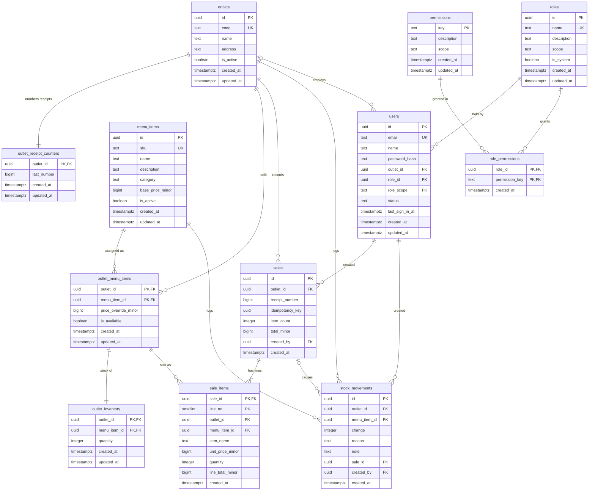

# POS System - Database Design

> **Status:** target design, 2026-11-25; each feature's spec confirms or changes its part.
> Nothing is built yet.
> Items marked "(proposed)" add to the shared design brief and need confirming in the feature spec that builds them.

## Purpose and scope

POS System keeps all of its data in one PostgreSQL 18 database, in one schema called `pos`.
This document is the full rulebook for that database: the tables, the keys and indexes, the roles, the sale transaction, migrations, connections, backups and the path to a bigger setup.
`.claude/rules/database.md` and `.claude/rules/sales.md` are the short versions of it and must agree with it.

- **Covers:** outlets, the master menu, outlet assignments and prices, stock, sales and sale lines, users, roles and permissions; constraints and indexes; database roles and grants; transactions and concurrency; migrations and pgtyped; connections; backups and seed data; the scaling path.
- **Readers:** anyone writing a migration, a `.sql` query file or a repository, and anyone reviewing a schema change.
- **Out of scope:** payments, refunds and voids, taxes and discounts, shifts, printers and the kitchen display system (KDS).
  The offline POS mode and the full scaling plan live in the architecture document; this document only covers what they need from the database.
- **Launch size:** one company, a handful of outlets, a Postgres container on one EC2 `t4g.small` instance (2 vCPU, 2 GiB memory), data on a separate EBS (Elastic Block Store) volume.

## Key decisions and why

The rule behind all of these: correctness of stock and receipt numbers is the point of the product, so the database is designed to refuse bad data, not just store good data.

| Decision | Why | Given up |
| --- | --- | --- |
| One schema, `pos`, owned by `migrator` | One place to grant from; nothing lives in `public`; an unqualified table name fails instead of finding the wrong table. | Every query writes `pos.` in front of each table. |
| The API connects as `pos_app`, with data access only | A bug or an injected query in the API cannot drop or alter a table, and frozen tables refuse `UPDATE` and `DELETE` at the grant level. | Two roles and two connection strings to manage. |
| UUIDv7 primary keys, generated in the API | The API knows the ID before the insert, so a sale, its lines and its stock movements are written without a round trip to read IDs back. UUIDv7 is time-ordered, so new rows land at the end of the index like a sequence would. | 16-byte keys instead of 8; IDs are not friendly to read, so sales get a separate receipt number. |
| Money as `bigint` minor units (`_minor`) | Integers add and multiply exactly; a float cannot hold 0.10 exactly. | Formatting happens in code (`web/src/lib/money.ts`). |
| Times as `timestamptz` | Every value is an exact instant, stored in UTC, whatever the server or client time zone. | Reports must say which time zone a "day" is in. |
| Status values as `text` with `CHECK (... IN (...))` | Adding a value is one `ALTER TABLE`; Postgres enums are harder to change and cannot drop a value. | No type-level listing of the values; the `CHECK` is the list. |
| Constraints as the last line of defence | The service checks every rule first and gives a clear error; the database refuses anything that slips past, so a bug cannot store negative stock or a duplicate receipt number. | Some rules are written twice, once in TypeScript and once in SQL. |
| Frozen sale history | A sale line stores the item name and unit price at the time of sale, so an old receipt reads the same after a price change. Everything else joins live data. | A few copied columns on `sale_items`. |
| No ORM; SQL files with pgtyped | The sale transaction depends on exact SQL (conditional updates, `RETURNING`, lock order), which an ORM hides. pgtyped checks every query against the real schema and generates typed functions, so a schema change shows up as compile errors. | Queries are written by hand. |
| No triggers (proposed) | Every write is visible in the `.sql` file that does it; `updated_at = now()` is set in each `UPDATE`. | A forgotten `updated_at` is caught by review, not by the database. |
| No database defaults for IDs (proposed) | A forgotten ID fails the insert loudly instead of quietly using a different generator. Postgres 18 has `uuidv7()`, but it is only for manual SQL and tests. | Every insert passes its ID. |

## Entity relationship diagram

Twelve tables in four areas: outlets and receipt numbers, menu and stock, sales, and access control.



How to read the relationships:

- **An outlet sells an item only through an assignment.** `outlet_menu_items` links an outlet to a master item and holds the optional price override; its stock row and every sale line point at the assignment, not at the bare item, so the database refuses a sale line for an item the outlet does not have.
- **Stock is one row per assignment.** `outlet_inventory` has the same key as `outlet_menu_items` and is created with it, at zero.
- **Every stock change leaves a movement.** `stock_movements` is the append-only history of sales, restocks and adjustments; a movement caused by a sale points at that sale.
- **A sale line carries the outlet twice on purpose.** `sale_items.outlet_id` is copied from the sale for reports, and a composite foreign key to `sales (id, outlet_id)` makes sure the copy matches (proposed).
- **One role per user.** A user with no outlet is an HQ user and must hold an `hq` role; an outlet user must hold an `outlet` role, enforced by a composite foreign key (proposed, see `users`).

## Conventions

Every table follows the same rules, so a reviewer can spot a mistake without knowing the feature.

| Topic | Rule |
| --- | --- |
| Schema | Every table lives in `pos`. Every query names the schema (`pos.sales`); no role has `pos` on its `search_path`, so a missing prefix fails at once. |
| Table names | `snake_case`, plural (`sales`, `sale_items`). A link table is named after both sides (`role_permissions`, `outlet_menu_items`). |
| Column names | `snake_case`. Foreign keys are `<thing>_id`. Booleans start with `is_`. Money ends in `_minor`. Times end in `_at`. |
| Primary keys | `id uuid`, a UUIDv7 generated by the API. Link and child tables use a composite key instead (`(outlet_id, menu_item_id)`, `(sale_id, line_no)`). The permission catalog is keyed by its text `key`. No `serial` or identity columns, and no sequences. |
| Human numbers | Receipt numbers come from a per-outlet counter row, never from a sequence (see Transactions). Shown as `<outlet code>-<zero-padded number>`, for example `DHK01-000123`; stored as the integer. |
| Money | `bigint` minor units, never `numeric` or float. One currency for the whole company, configured once (`CURRENCY`, default `BDT`) and shown with two decimals, so no currency column (proposed). |
| Quantities | `integer` units. |
| Time | `timestamptz`, default `now()`. Every table has `created_at`; tables whose rows change also have `updated_at`, which each `UPDATE` sets to `now()`. |
| Status values | `text` with a `CHECK (col IN (...))`. |
| Lengths | Free text gets a `CHECK` on `char_length` matching the zod limit, so the database refuses a value the validator should have stopped (proposed limits, listed per table). |
| Foreign keys | Always declared. `ON DELETE RESTRICT` unless a section says otherwise and why. Outlets, menu items, users and sales are never deleted; they are deactivated or kept forever. A delete blocked by `RESTRICT` fails with SQLSTATE `23001` (`restrict_violation`), not `23503`; see `mapPgError`. |
| Deleting | No soft-delete columns. Things that history points at have `is_active` or `status`. Only roles, role permissions and unused assignments are ever deleted. |
| Constraint names | Inline constraints (`PRIMARY KEY`, `UNIQUE`, `CHECK`, `REFERENCES`) keep Postgres's automatic names, for example `sales_outlet_id_receipt_number_key` and `outlet_inventory_quantity_check`. Code that must recognise a constraint compares against that automatic name, held in one constant next to the repository. |
| Index names | Indexes we create by name: `ix_<table>_<columns>`; unique indexes: `ux_<table>_<columns>`; an expression is named after what it does (`ux_users_lower_email`). |
| Indexed foreign keys | Every foreign key column used in a join or a filter is indexed, because Postgres does not do it. A foreign key that is never filtered on and whose parent is never deleted (`created_by`, `stock_movements.sale_id`) is left unindexed on purpose. |

## Database roles

Two login roles, both created by the init script on a fresh volume.
The API never connects as the superuser, and nothing in the repository does except the init script.

| Role | Used by | Rights |
| --- | --- | --- |
| `postgres` (superuser) | `deploy/initdb/01-roles.sh`, once, on first start | Everything. Its password exists only to initialise the volume. |
| `migrator` | `npm run migrate` (the `migrate` service in Compose); the test helper that resets data | Owns schema `pos` and every table in it, so it needs no grants. Runs DDL (Data Definition Language: `CREATE`, `ALTER`, `DROP`) and the permission catalog sync. Not a superuser, cannot create roles or databases. |
| `pos_app` | The API and `npm run seed` | `CONNECT` on the database, `USAGE` on schema `pos`, and only the table privileges each migration grants. No DDL, no `TRUNCATE`, cannot create objects anywhere. |

### What the init script does

`deploy/initdb/01-roles.sh` runs from `/docker-entrypoint-initdb.d`, so Postgres runs it only when the data directory is empty.
The same script is mounted by the local `docker-compose.yml` and by the testcontainers helper, so local runs, tests and production build the roles the same way.
Passwords come from the environment (`MIGRATOR_PASSWORD`, `APP_DB_PASSWORD`) and are read with `\getenv`, so they never appear on a command line.

```sql
\getenv migrator_password MIGRATOR_PASSWORD
\getenv app_password APP_DB_PASSWORD

CREATE ROLE migrator LOGIN NOSUPERUSER NOCREATEDB NOCREATEROLE PASSWORD :'migrator_password';
CREATE ROLE pos_app  LOGIN NOSUPERUSER NOCREATEDB NOCREATEROLE PASSWORD :'app_password';

REVOKE ALL ON DATABASE pos FROM PUBLIC;
GRANT CONNECT ON DATABASE pos TO migrator, pos_app;
GRANT CREATE ON DATABASE pos TO migrator;
REVOKE CREATE ON SCHEMA public FROM PUBLIC;

CREATE SCHEMA pos AUTHORIZATION migrator;
GRANT USAGE ON SCHEMA pos TO pos_app;

ALTER DEFAULT PRIVILEGES FOR ROLE migrator IN SCHEMA pos
  GRANT SELECT, INSERT, UPDATE, DELETE ON TABLES TO pos_app;
ALTER DEFAULT PRIVILEGES FOR ROLE migrator IN SCHEMA pos
  GRANT USAGE ON SEQUENCES TO pos_app;

ALTER ROLE pos_app SET statement_timeout = '5s';
ALTER ROLE pos_app SET lock_timeout = '2s';
ALTER ROLE pos_app SET idle_in_transaction_session_timeout = '10s';
ALTER ROLE migrator SET lock_timeout = '5s';
```

- `POSTGRES_DB=pos` makes the container create the `pos` database before the script runs.
- `GRANT CREATE ON DATABASE` lets `migrator` create the migration runner's own bookkeeping schema, `pos_migrations` (proposed), which `pos_app` cannot see.
- `REVOKE CREATE ON SCHEMA public` is already the default since Postgres 15; it stays in the script as a statement of intent.
- The session settings are explained in [How the API connects](#how-the-api-connects).

### How grants work

Two layers, so a new table is never reachable by accident and never unreachable by accident.

1. **Default privileges** (set once by the init script): every table `migrator` creates in `pos` gives `pos_app` `SELECT, INSERT, UPDATE, DELETE`.
   This is the baseline, and it is why `pos_app` needs no `GRANT` after a plain `ALTER TABLE`.
2. **Each migration states the exact grant** for every table it creates, with `REVOKE ALL` followed by the `GRANT` the table needs.
   The migration file is then the full truth about who can do what, without reading the init script.

The resulting access for `pos_app`:

| Table | `pos_app` may | Why |
| --- | --- | --- |
| `outlets`, `menu_items`, `users` | `SELECT, INSERT, UPDATE` | History points at them; they are deactivated, never deleted (proposed). |
| `outlet_receipt_counters` | `SELECT, INSERT, UPDATE` | Created with the outlet, bumped by every sale, never deleted. |
| `outlet_menu_items`, `outlet_inventory` | `SELECT, INSERT, UPDATE, DELETE` | Unassigning an unused item deletes both rows. |
| `roles`, `role_permissions` | `SELECT, INSERT, UPDATE, DELETE` | HQ edits and deletes roles. |
| `permissions` | `SELECT` | Only the `migrate` CLI writes the catalog, as `migrator`. |
| `sales`, `sale_items`, `stock_movements` | `SELECT, INSERT` | Frozen history and an append-only audit trail; the API cannot change or remove them even with a bug (proposed). |

A test in `src/platform/db` connects as `pos_app` and pins these rights: it must fail to `UPDATE pos.sales`, to `DELETE FROM pos.stock_movements`, to write `pos.permissions` and to run any DDL (proposed).

## Tables

The `CREATE TABLE` statements below are the target shape of the migrations, in dependency order.
Feature specs split them into numbered migration files; see [Migrations and schema changes](#migrations-and-schema-changes).

### `outlets`

One row per outlet (a restaurant, cafe or kiosk).
Created by HQ with `outlets.manage`.

| Column | Type | Null | Default | Notes |
| --- | --- | --- | --- | --- |
| `id` | `uuid` | no | | UUIDv7 from the API. |
| `code` | `text` | no | | Short code shown in receipt numbers, for example `DHK01`. 2-10 uppercase letters or digits (proposed). Never changes once created (proposed), because printed receipts carry it. |
| `name` | `text` | no | | 1-120 characters (proposed). |
| `address` | `text` | yes | | Up to 500 characters (proposed). |
| `is_active` | `boolean` | no | `true` | An inactive outlet cannot sell; its history stays. |
| `created_at` | `timestamptz` | no | `now()` | |
| `updated_at` | `timestamptz` | no | `now()` | |

- **Constraints:** primary key `id`; `UNIQUE (code)`; format `CHECK` on `code`; length `CHECK`s.
- **Indexes:** the primary key and the unique constraint only; the table holds tens of rows.
- **Created with its counter:** the use case that creates an outlet inserts its `outlet_receipt_counters` row in the same transaction.

```sql
CREATE TABLE pos.outlets (
  id          uuid PRIMARY KEY,
  code        text NOT NULL UNIQUE CHECK (code ~ '^[A-Z0-9]{2,10}$'),
  name        text NOT NULL CHECK (char_length(name) BETWEEN 1 AND 120),
  address     text CHECK (char_length(address) <= 500),
  is_active   boolean NOT NULL DEFAULT true,
  created_at  timestamptz NOT NULL DEFAULT now(),
  updated_at  timestamptz NOT NULL DEFAULT now()
);
```

### `outlet_receipt_counters`

One row per outlet holding the last receipt number it issued.
This row is the only thing that serialises sales at one outlet, and only for the last few milliseconds of each sale.

| Column | Type | Null | Default | Notes |
| --- | --- | --- | --- | --- |
| `outlet_id` | `uuid` | no | | Primary key and foreign key to `outlets`. |
| `last_number` | `bigint` | no | `0` | The last receipt number issued; the next sale gets `last_number + 1`. |
| `created_at` | `timestamptz` | no | `now()` | Added to follow the every-table rule (proposed). |
| `updated_at` | `timestamptz` | no | `now()` | Set by each increment, so it doubles as "last sale at" (proposed). |

- **Constraints:** primary key `outlet_id`; foreign key to `outlets` (`RESTRICT`); `CHECK (last_number >= 0)`.
- **Indexes:** the primary key.
- **Why a separate table and not a column on `outlets`:** the counter row is locked by every sale; keeping it apart means an HQ edit of the outlet name never waits behind a sale, and a sale never waits behind an outlet edit.

```sql
CREATE TABLE pos.outlet_receipt_counters (
  outlet_id    uuid PRIMARY KEY REFERENCES pos.outlets (id) ON DELETE RESTRICT,
  last_number  bigint NOT NULL DEFAULT 0 CHECK (last_number >= 0),
  created_at   timestamptz NOT NULL DEFAULT now(),
  updated_at   timestamptz NOT NULL DEFAULT now()
);
```

### `menu_items`

The master menu, owned by HQ (`menu.manage`).
An outlet sees an item only once it is assigned.

| Column | Type | Null | Default | Notes |
| --- | --- | --- | --- | --- |
| `id` | `uuid` | no | | UUIDv7 from the API. |
| `sku` | `text` | no | | Stock keeping unit, unique across the company. Uppercase letters, digits and dashes, 1-40 characters (proposed); the API uppercases input. |
| `name` | `text` | no | | 1-120 characters (proposed). |
| `description` | `text` | yes | | Up to 1000 characters (proposed). |
| `category` | `text` | yes | | Free text such as `Coffee` or `Bakery`, used to group the sell screen. 1-60 characters (proposed). |
| `base_price_minor` | `bigint` | no | | The master price in minor units. |
| `is_active` | `boolean` | no | `true` | An inactive item cannot be sold anywhere. |
| `created_at` | `timestamptz` | no | `now()` | |
| `updated_at` | `timestamptz` | no | `now()` | |

- **Constraints:** primary key `id`; `UNIQUE (sku)`; `CHECK (base_price_minor >= 0)`; format and length `CHECK`s.
- **Indexes:** the primary key and the unique constraint.
  The master list is a few hundred rows at most and is read whole, sorted by name, so it needs nothing more.
- **Categories stay free text** for now; a `categories` table is worth it only when categories get their own order, colour or availability.

```sql
CREATE TABLE pos.menu_items (
  id                uuid PRIMARY KEY,
  sku               text NOT NULL UNIQUE CHECK (sku ~ '^[A-Z0-9][A-Z0-9-]{0,39}$'),
  name              text NOT NULL CHECK (char_length(name) BETWEEN 1 AND 120),
  description       text CHECK (char_length(description) <= 1000),
  category          text CHECK (char_length(category) BETWEEN 1 AND 60),
  base_price_minor  bigint NOT NULL CHECK (base_price_minor >= 0),
  is_active         boolean NOT NULL DEFAULT true,
  created_at        timestamptz NOT NULL DEFAULT now(),
  updated_at        timestamptz NOT NULL DEFAULT now()
);
```

### `outlet_menu_items`

The assignment of a master item to an outlet, with an optional price override (`menu.assign`).
Effective price is `COALESCE(price_override_minor, base_price_minor)`.

| Column | Type | Null | Default | Notes |
| --- | --- | --- | --- | --- |
| `outlet_id` | `uuid` | no | | Foreign key to `outlets`. |
| `menu_item_id` | `uuid` | no | | Foreign key to `menu_items`. |
| `price_override_minor` | `bigint` | yes | | Null means "use the master price". |
| `is_available` | `boolean` | no | `true` | The outlet's switch for "not selling this today". |
| `created_at` | `timestamptz` | no | `now()` | |
| `updated_at` | `timestamptz` | no | `now()` | |

- **Constraints:** primary key `(outlet_id, menu_item_id)`; foreign keys to `outlets` and `menu_items` (`RESTRICT`); `CHECK (price_override_minor >= 0)`.
- **Indexes:** the primary key serves "the menu of one outlet"; `ix_outlet_menu_items_menu_item_id` serves "which outlets sell this item" on the HQ item screen and the foreign key check.
- **An item is sellable** when the assignment exists, `is_available` is true and the master item `is_active` is true.
- **Assigning** (`PUT /outlets/:outletId/menu/:menuItemId`) is an upsert of this row plus an `INSERT ... ON CONFLICT DO NOTHING` of the stock row at zero, in one transaction:

  ```sql
  INSERT INTO pos.outlet_menu_items (outlet_id, menu_item_id, price_override_minor, is_available)
  VALUES (:outletId!, :menuItemId!, :priceOverrideMinor, :isAvailable!)
  ON CONFLICT (outlet_id, menu_item_id) DO UPDATE
     SET price_override_minor = EXCLUDED.price_override_minor,
         is_available = EXCLUDED.is_available,
         updated_at = now()
  RETURNING outlet_id, menu_item_id, price_override_minor, is_available;

  INSERT INTO pos.outlet_inventory (outlet_id, menu_item_id, quantity)
  VALUES (:outletId!, :menuItemId!, 0)
  ON CONFLICT (outlet_id, menu_item_id) DO NOTHING;
  ```

- **Unassigning** (`DELETE`) is refused with 409 once the item has stock or sales at the outlet, and the database enforces both halves:
  the stock row is deleted only `WHERE quantity = 0` (no row returned means stock is left), and the assignment delete fails with `23001` on `sale_items_outlet_id_menu_item_id_fkey` if any `sale_items` row points at it.
  The service turns either into its own 409 error and suggests marking the item unavailable instead.

```sql
CREATE TABLE pos.outlet_menu_items (
  outlet_id             uuid NOT NULL REFERENCES pos.outlets (id) ON DELETE RESTRICT,
  menu_item_id          uuid NOT NULL REFERENCES pos.menu_items (id) ON DELETE RESTRICT,
  price_override_minor  bigint CHECK (price_override_minor >= 0),
  is_available          boolean NOT NULL DEFAULT true,
  created_at            timestamptz NOT NULL DEFAULT now(),
  updated_at            timestamptz NOT NULL DEFAULT now(),
  PRIMARY KEY (outlet_id, menu_item_id)
);

CREATE INDEX ix_outlet_menu_items_menu_item_id ON pos.outlet_menu_items (menu_item_id);
```

### `outlet_inventory`

Stock on hand, one row per assignment.
The `CHECK (quantity >= 0)` is the backstop that makes negative stock impossible, whatever the code does.

| Column | Type | Null | Default | Notes |
| --- | --- | --- | --- | --- |
| `outlet_id` | `uuid` | no | | Part of the foreign key to `outlet_menu_items`. |
| `menu_item_id` | `uuid` | no | | Part of the foreign key to `outlet_menu_items`. |
| `quantity` | `integer` | no | `0` | Units on hand. |
| `created_at` | `timestamptz` | no | `now()` | Added to follow the every-table rule (proposed). |
| `updated_at` | `timestamptz` | no | `now()` | Set by every stock change. |

- **Constraints:** primary key `(outlet_id, menu_item_id)`; foreign key `(outlet_id, menu_item_id)` to `outlet_menu_items` (`RESTRICT`, so the stock row must be deleted on purpose before its assignment); `CHECK (quantity >= 0)`.
- **Indexes:** the primary key, which serves both the conditional stock update and the join to the outlet menu.
- **Every change is a conditional `UPDATE ... RETURNING`** (see Transactions); nothing ever reads the quantity and then writes it.

```sql
CREATE TABLE pos.outlet_inventory (
  outlet_id     uuid NOT NULL,
  menu_item_id  uuid NOT NULL,
  quantity      integer NOT NULL DEFAULT 0 CHECK (quantity >= 0),
  created_at    timestamptz NOT NULL DEFAULT now(),
  updated_at    timestamptz NOT NULL DEFAULT now(),
  PRIMARY KEY (outlet_id, menu_item_id),
  FOREIGN KEY (outlet_id, menu_item_id)
    REFERENCES pos.outlet_menu_items (outlet_id, menu_item_id) ON DELETE RESTRICT
);
```

### `roles`

A named set of permissions.
`HQ Admin` is built in and locked (`is_system`); `Outlet Manager` and `Cashier` are seeded and editable; HQ creates the rest (`roles.manage`).

| Column | Type | Null | Default | Notes |
| --- | --- | --- | --- | --- |
| `id` | `uuid` | no | | UUIDv7 from the API. |
| `name` | `text` | no | | Unique. 1-60 characters (proposed). |
| `description` | `text` | yes | | Up to 300 characters (proposed). |
| `scope` | `text` | no | | `hq` or `outlet`: which kind of user may hold it. Fixed once created (proposed). |
| `is_system` | `boolean` | no | `false` | A system role refuses edit and delete, in the service. |
| `created_at` | `timestamptz` | no | `now()` | |
| `updated_at` | `timestamptz` | no | `now()` | |

- **Constraints:** primary key `id`; `UNIQUE (name)`; `CHECK (scope IN ('hq', 'outlet'))`; `UNIQUE (id, scope)` (proposed), which exists only so `users` can point at a role and its scope together.
- **Indexes:** the primary key and the two unique constraints.
- **Deleting a role in use** fails on the `users` foreign key with `23001` on `users_role_id_role_scope_fkey`; the service checks first and answers 409, and maps that error to the same 409 if a user is assigned in between.

```sql
CREATE TABLE pos.roles (
  id           uuid PRIMARY KEY,
  name         text NOT NULL UNIQUE CHECK (char_length(name) BETWEEN 1 AND 60),
  description  text CHECK (char_length(description) <= 300),
  scope        text NOT NULL CHECK (scope IN ('hq', 'outlet')),
  is_system    boolean NOT NULL DEFAULT false,
  created_at   timestamptz NOT NULL DEFAULT now(),
  updated_at   timestamptz NOT NULL DEFAULT now(),
  UNIQUE (id, scope)
);
```

### `permissions`

The permission catalog, copied from `api/src/modules/roles/permission.ts` by the `migrate` CLI on every run.
Nobody edits it by hand and `pos_app` can only read it.

| Column | Type | Null | Default | Notes |
| --- | --- | --- | --- | --- |
| `key` | `text` | no | | `area.action`, for example `sales.create`. |
| `description` | `text` | no | | Shown on the role editor. |
| `scope` | `text` | no | | `hq`, `outlet` or `any`: which kind of role may hold it. |
| `created_at` | `timestamptz` | no | `now()` | Added to follow the every-table rule (proposed). |
| `updated_at` | `timestamptz` | no | `now()` | Set when the sync changes a description or scope (proposed). |

- **Constraints:** primary key `key`; `CHECK (key ~ '^[a-z]+\.[a-z]+$')` (proposed); `CHECK (scope IN ('hq', 'outlet', 'any'))`.
- **Indexes:** the primary key.
- **The sync**, run by `npm run migrate` after the migrations, as `migrator`, in one transaction:
  1. Upsert every key from `permission.ts` with its description and scope.
  2. Delete keys that are no longer in the code; `ON DELETE CASCADE` on `role_permissions` takes them off every role, and the CLI logs a warning naming each one.
  3. Make sure the `HQ Admin` system role exists and holds exactly every `hq` and `any` key (proposed: the CLI owns the system role, so it is correct on a database that was never seeded).
- **A role may hold only keys of its own scope or `any`.** This is checked in the roles service, not by a constraint.

```sql
CREATE TABLE pos.permissions (
  key          text PRIMARY KEY CHECK (key ~ '^[a-z]+\.[a-z]+$'),
  description  text NOT NULL,
  scope        text NOT NULL CHECK (scope IN ('hq', 'outlet', 'any')),
  created_at   timestamptz NOT NULL DEFAULT now(),
  updated_at   timestamptz NOT NULL DEFAULT now()
);
```

### `role_permissions`

Which keys each role holds.

| Column | Type | Null | Default | Notes |
| --- | --- | --- | --- | --- |
| `role_id` | `uuid` | no | | Foreign key to `roles`. |
| `permission_key` | `text` | no | | Foreign key to `permissions`. |
| `created_at` | `timestamptz` | no | `now()` | When the key was granted (proposed). |

- **Constraints:** primary key `(role_id, permission_key)`; foreign key to `roles` with `ON DELETE CASCADE` (deleting a role removes its grants); foreign key to `permissions` with `ON DELETE CASCADE` (a key removed from the code is removed from every role).
  These are the only two cascades in the schema, and both delete link rows, never history.
- **Indexes:** the primary key serves "permissions of a role" (sign-in and the role editor); `ix_role_permissions_permission_key` serves the cascade from `permissions` and "which roles hold this key" (proposed).
- **Editing a role's keys** replaces the set in one transaction: delete the keys no longer wanted, insert the new ones with `ON CONFLICT DO NOTHING`.

```sql
CREATE TABLE pos.role_permissions (
  role_id         uuid NOT NULL REFERENCES pos.roles (id) ON DELETE CASCADE,
  permission_key  text NOT NULL REFERENCES pos.permissions (key) ON DELETE CASCADE,
  created_at      timestamptz NOT NULL DEFAULT now(),
  PRIMARY KEY (role_id, permission_key)
);

CREATE INDEX ix_role_permissions_permission_key ON pos.role_permissions (permission_key);
```

### `users`

Everyone who signs in.
A user with `outlet_id` null is an HQ user; otherwise the user belongs to exactly one outlet.

| Column | Type | Null | Default | Notes |
| --- | --- | --- | --- | --- |
| `id` | `uuid` | no | | UUIDv7 from the API. |
| `email` | `text` | no | | Stored as entered; unique ignoring case. 3-254 characters with an `@` (proposed). |
| `name` | `text` | no | | 1-120 characters (proposed). |
| `password_hash` | `text` | no | | argon2id hash in its standard encoded form; never logged, never returned. |
| `outlet_id` | `uuid` | yes | | Null means HQ user. |
| `role_id` | `uuid` | no | | The user's one role. |
| `role_scope` | `text` | no | generated | `'hq'` when `outlet_id` is null, else `'outlet'`. Stored generated column (proposed). |
| `status` | `text` | no | `'active'` | `active` or `disabled`; a disabled user cannot sign in. |
| `last_sign_in_at` | `timestamptz` | yes | | Set by a successful sign-in. |
| `created_at` | `timestamptz` | no | `now()` | |
| `updated_at` | `timestamptz` | no | `now()` | |

- **Constraints:** primary key `id`; unique index on `lower(email)`; foreign key `outlet_id` to `outlets`; foreign key `(role_id, role_scope)` to `roles (id, scope)` (proposed); `CHECK (status IN ('active', 'disabled'))`; length `CHECK`s.
- **Why the generated `role_scope`:** the brief's rule "HQ users get `hq` roles, outlet users get `outlet` roles" spans two tables, so a plain `CHECK` cannot hold it.
  Deriving the user's kind from `outlet_id` and pointing the foreign key at `(id, scope)` makes Postgres refuse an outlet user with an HQ role, including when an edit moves a user between HQ and an outlet without changing the role.
  The service still checks first and gives the clear error.
- **Indexes:** `ux_users_lower_email` serves sign-in and the duplicate check; `ix_users_outlet_id` serves the user list filtered by outlet; `ix_users_role_id` serves the list filtered by role and the foreign key check when a role is deleted (proposed).
- **Users are never deleted**, only disabled, because sales and stock movements point at them.

```sql
CREATE TABLE pos.users (
  id               uuid PRIMARY KEY,
  email            text NOT NULL CHECK (char_length(email) BETWEEN 3 AND 254 AND position('@' IN email) > 1),
  name             text NOT NULL CHECK (char_length(name) BETWEEN 1 AND 120),
  password_hash    text NOT NULL,
  outlet_id        uuid REFERENCES pos.outlets (id) ON DELETE RESTRICT,
  role_id          uuid NOT NULL,
  role_scope       text NOT NULL GENERATED ALWAYS AS (CASE WHEN outlet_id IS NULL THEN 'hq' ELSE 'outlet' END) STORED,
  status           text NOT NULL DEFAULT 'active' CHECK (status IN ('active', 'disabled')),
  last_sign_in_at  timestamptz,
  created_at       timestamptz NOT NULL DEFAULT now(),
  updated_at       timestamptz NOT NULL DEFAULT now(),
  FOREIGN KEY (role_id, role_scope) REFERENCES pos.roles (id, scope) ON DELETE RESTRICT
);

CREATE UNIQUE INDEX ux_users_lower_email ON pos.users (lower(email));
CREATE INDEX ix_users_outlet_id ON pos.users (outlet_id);
CREATE INDEX ix_users_role_id ON pos.users (role_id);
```

### `sales`

One row per completed sale.
Rows are inserted once and never changed; `pos_app` has no `UPDATE` or `DELETE` on this table.

| Column | Type | Null | Default | Notes |
| --- | --- | --- | --- | --- |
| `id` | `uuid` | no | | UUIDv7 from the API. |
| `outlet_id` | `uuid` | no | | The outlet that made the sale. |
| `receipt_number` | `bigint` | no | | Per-outlet number from `outlet_receipt_counters`, starting at 1, no gaps. |
| `idempotency_key` | `uuid` | yes | | The `Idempotency-Key` header, when sent. |
| `item_count` | `integer` | no | | Total units across all lines (proposed meaning), for the sales list. |
| `total_minor` | `bigint` | no | | Sum of `line_total_minor`, computed in the service. |
| `created_by` | `uuid` | no | | The user who made the sale. |
| `created_at` | `timestamptz` | no | `now()` | The transaction's start time. |

- **Constraints:** primary key `id`; `UNIQUE (outlet_id, receipt_number)`; `UNIQUE (outlet_id, idempotency_key)` (nulls never clash, so sales without a key are unaffected); `UNIQUE (id, outlet_id)` (proposed, the target of the `sale_items` composite foreign key); `CHECK (receipt_number > 0)`; `CHECK (item_count > 0)` (proposed); `CHECK (total_minor >= 0)`; foreign keys to `outlets` and `users`.
- **Automatic constraint names the code relies on:** `sales_outlet_id_idempotency_key_key` (a unique violation on it means "this key already made a sale": return that sale) and `sales_outlet_id_receipt_number_key` (should never fire; if it does, it is a bug, so the repository rethrows it as `unexpected`, a logged 500, instead of letting `mapPgError` call it a `conflict`).
- **Indexes:** `ix_sales_outlet_id_created_at` with `INCLUDE (total_minor)` serves date-range filters and the revenue report straight from the index (the `INCLUDE` is proposed); the receipt number unique index serves the sales list (see Indexes and query patterns).
- **`created_by` is not indexed:** nothing filters on it yet, and users are never deleted, so no foreign key check needs it.
  A "sales by cashier" report would add `ix_sales_created_by_created_at`.

```sql
CREATE TABLE pos.sales (
  id               uuid PRIMARY KEY,
  outlet_id        uuid NOT NULL REFERENCES pos.outlets (id) ON DELETE RESTRICT,
  receipt_number   bigint NOT NULL CHECK (receipt_number > 0),
  idempotency_key  uuid,
  item_count       integer NOT NULL CHECK (item_count > 0),
  total_minor      bigint NOT NULL CHECK (total_minor >= 0),
  created_by       uuid NOT NULL REFERENCES pos.users (id) ON DELETE RESTRICT,
  created_at       timestamptz NOT NULL DEFAULT now(),
  UNIQUE (outlet_id, receipt_number),
  UNIQUE (outlet_id, idempotency_key),
  UNIQUE (id, outlet_id)
);

CREATE INDEX ix_sales_outlet_id_created_at ON pos.sales (outlet_id, created_at) INCLUDE (total_minor);
```

### `sale_items`

The lines of a sale, with the item name and unit price frozen at the time of sale.

| Column | Type | Null | Default | Notes |
| --- | --- | --- | --- | --- |
| `sale_id` | `uuid` | no | | The sale. |
| `line_no` | `smallint` | no | | 1, 2, 3 in the sorted line order. |
| `outlet_id` | `uuid` | no | | Copied from the sale, for reports. |
| `menu_item_id` | `uuid` | no | | The item sold. |
| `item_name` | `text` | no | | Frozen copy of `menu_items.name`. |
| `unit_price_minor` | `bigint` | no | | Frozen effective price. |
| `quantity` | `integer` | no | | Units sold on this line. |
| `line_total_minor` | `bigint` | no | | `unit_price_minor * quantity`. |
| `created_at` | `timestamptz` | no | `now()` | Equal to the sale's `created_at`, because `now()` is fixed for the whole transaction (proposed). |

- **Constraints:** primary key `(sale_id, line_no)`; foreign key `(sale_id, outlet_id)` to `sales (id, outlet_id)`, so the copied outlet always matches the sale (proposed); foreign key `(outlet_id, menu_item_id)` to `outlet_menu_items`, so a line can only sell an item assigned to that outlet and an assignment with sales cannot be removed (proposed); `CHECK (line_no >= 1)`; `CHECK (quantity > 0)`; `CHECK (unit_price_minor >= 0)`; `CHECK (line_total_minor = unit_price_minor * quantity)` (proposed).
- **Indexes:** the primary key serves "the lines of a sale"; `ix_sale_items_outlet_id_menu_item_id` serves the top items report and the foreign key check on unassign.
- **No unique `(sale_id, menu_item_id)`:** the service merges duplicate items into one line, and a duplicate would harm nothing in the database, so it is not worth another index on the busiest insert path.

```sql
CREATE TABLE pos.sale_items (
  sale_id           uuid NOT NULL,
  line_no           smallint NOT NULL CHECK (line_no >= 1),
  outlet_id         uuid NOT NULL,
  menu_item_id      uuid NOT NULL,
  item_name         text NOT NULL,
  unit_price_minor  bigint NOT NULL CHECK (unit_price_minor >= 0),
  quantity          integer NOT NULL CHECK (quantity > 0),
  line_total_minor  bigint NOT NULL,
  created_at        timestamptz NOT NULL DEFAULT now(),
  PRIMARY KEY (sale_id, line_no),
  FOREIGN KEY (sale_id, outlet_id) REFERENCES pos.sales (id, outlet_id) ON DELETE RESTRICT,
  FOREIGN KEY (outlet_id, menu_item_id)
    REFERENCES pos.outlet_menu_items (outlet_id, menu_item_id) ON DELETE RESTRICT,
  CHECK (line_total_minor = unit_price_minor * quantity)
);

CREATE INDEX ix_sale_items_outlet_id_menu_item_id ON pos.sale_items (outlet_id, menu_item_id);
```

### `stock_movements`

The append-only audit trail of every stock change: one row per sale line, restock or adjustment.
`pos_app` has `SELECT` and `INSERT` only.

| Column | Type | Null | Default | Notes |
| --- | --- | --- | --- | --- |
| `id` | `uuid` | no | | UUIDv7 from the API. |
| `outlet_id` | `uuid` | no | | Foreign key to `outlets`. |
| `menu_item_id` | `uuid` | no | | Foreign key to `menu_items`. |
| `change` | `integer` | no | | Signed change in units: negative for sales. |
| `reason` | `text` | no | | `sale`, `restock` or `adjustment`. |
| `note` | `text` | yes | | Why an adjustment was made. Up to 500 characters (proposed). |
| `sale_id` | `uuid` | yes | | The sale, when `reason = 'sale'`. |
| `created_by` | `uuid` | no | | The user who made the change. |
| `created_at` | `timestamptz` | no | `now()` | |

- **Constraints:** primary key `id`; foreign keys to `outlets`, `menu_items`, `sales` and `users`; `CHECK (reason IN ('sale', 'restock', 'adjustment'))`; and three rules that keep the trail honest (proposed):
  `CHECK (change <> 0)`, `CHECK ((reason = 'sale') = (sale_id IS NOT NULL))` (a sale movement always names its sale, and only sale movements do), `CHECK (reason <> 'sale' OR change < 0)` and `CHECK (reason <> 'restock' OR change > 0)`.
- **Indexes:** `ix_stock_movements_outlet_id_menu_item_id_created_at` serves "history of one item at one outlet, newest first".
  `sale_id` and `created_by` are not indexed: nothing filters on them, and sales and users are never deleted.
- **Foreign keys point at `outlets` and `menu_items`, not at the assignment**, so an unassigned item keeps its history.
  A consequence: after an item is unassigned and assigned again, its stock starts at zero while older movements remain; the sum of movements equals the quantity only within one assignment.

```sql
CREATE TABLE pos.stock_movements (
  id            uuid PRIMARY KEY,
  outlet_id     uuid NOT NULL REFERENCES pos.outlets (id) ON DELETE RESTRICT,
  menu_item_id  uuid NOT NULL REFERENCES pos.menu_items (id) ON DELETE RESTRICT,
  change        integer NOT NULL CHECK (change <> 0),
  reason        text NOT NULL CHECK (reason IN ('sale', 'restock', 'adjustment')),
  note          text CHECK (char_length(note) <= 500),
  sale_id       uuid REFERENCES pos.sales (id) ON DELETE RESTRICT,
  created_by    uuid NOT NULL REFERENCES pos.users (id) ON DELETE RESTRICT,
  created_at    timestamptz NOT NULL DEFAULT now(),
  CHECK ((reason = 'sale') = (sale_id IS NOT NULL)),
  CHECK (reason <> 'sale' OR change < 0),
  CHECK (reason <> 'restock' OR change > 0)
);

CREATE INDEX ix_stock_movements_outlet_id_menu_item_id_created_at
  ON pos.stock_movements (outlet_id, menu_item_id, created_at);
```

### Grants in the migrations

Each migration ends with the grants for the tables it created.
For the full schema:

```sql
REVOKE ALL ON pos.outlets, pos.outlet_receipt_counters, pos.menu_items, pos.outlet_menu_items,
              pos.outlet_inventory, pos.roles, pos.permissions, pos.role_permissions, pos.users,
              pos.sales, pos.sale_items, pos.stock_movements FROM pos_app;

GRANT SELECT, INSERT, UPDATE ON pos.outlets, pos.outlet_receipt_counters, pos.menu_items, pos.users TO pos_app;
GRANT SELECT, INSERT, UPDATE, DELETE ON pos.outlet_menu_items, pos.outlet_inventory, pos.roles, pos.role_permissions TO pos_app;
GRANT SELECT ON pos.permissions TO pos_app;
GRANT SELECT, INSERT ON pos.sales, pos.sale_items, pos.stock_movements TO pos_app;
```

## Indexes and query patterns

Every important query maps to one index.
Primary keys and `UNIQUE` constraints create their own indexes; the table lists both kinds.

| Query | Where it runs | Index that serves it |
| --- | --- | --- |
| Outlet menu with effective price and stock | `GET /outlets/:outletId/menu`, the sell screen | `outlet_menu_items` primary key (prefix `outlet_id`), then `menu_items` and `outlet_inventory` primary keys |
| Price the lines of a sale | sale step 4 | `outlet_menu_items` primary key, `menu_items` primary key |
| Deduct stock | sale step 5, restock, adjust | `outlet_inventory` primary key |
| Next receipt number | sale step 6 | `outlet_receipt_counters` primary key |
| Insert sale, lines and movements | sale step 7 | writes every index on `sales`, `sale_items` and `stock_movements` (five, two and two, counting primary keys) |
| Idempotent replay lookup | sale step 2 | `sales_outlet_id_idempotency_key_key` |
| Sales list, newest first, keyset pages | `GET /outlets/:outletId/sales` | `sales_outlet_id_receipt_number_key`, read backwards |
| One sale with its lines | `GET /outlets/:outletId/sales/:saleId` | `sales` primary key, `sale_items` primary key (prefix `sale_id`) |
| Revenue by outlet | `GET /reports/revenue-by-outlet` | `ix_sales_outlet_id_created_at` (index-only, thanks to `INCLUDE (total_minor)`) |
| Top 5 items per outlet | `GET /reports/top-items` | `ix_sale_items_outlet_id_menu_item_id` |
| Stock history of an item | inventory screen | `ix_stock_movements_outlet_id_menu_item_id_created_at` |
| Sign-in by email | `POST /auth/login` | `ux_users_lower_email` |
| Permissions for a user | sign-in, `GET /me` | `role_permissions` primary key (prefix `role_id`) |
| Users by outlet or role | `GET /users` | `ix_users_outlet_id`, `ix_users_role_id` |
| Outlets selling an item | HQ item screen | `ix_outlet_menu_items_menu_item_id` |

### Example queries

Outlet menu, as `ListOutletMenu` in `menu.sql`.
The stock row always exists because it is created with the assignment, so an inner join is safe.
The query returns every assigned item with its flags; the sell screen shows only the sellable ones.

```sql
/* @name ListOutletMenu */
SELECT mi.id, mi.sku, mi.name, mi.description, mi.category,
       mi.base_price_minor, omi.price_override_minor,
       COALESCE(omi.price_override_minor, mi.base_price_minor) AS "effective_price_minor!",
       omi.is_available, mi.is_active, inv.quantity
  FROM pos.outlet_menu_items omi
  JOIN pos.menu_items mi ON mi.id = omi.menu_item_id
  JOIN pos.outlet_inventory inv
    ON inv.outlet_id = omi.outlet_id AND inv.menu_item_id = omi.menu_item_id
 WHERE omi.outlet_id = :outletId!
 ORDER BY mi.category NULLS LAST, mi.name;
```

Sign-in and permissions:

```sql
/* @name GetUserByEmail */
SELECT id, email, name, password_hash, outlet_id, role_id, status
  FROM pos.users
 WHERE lower(email) = lower(:email!);

/* @name ListRolePermissionKeys */
SELECT permission_key FROM pos.role_permissions WHERE role_id = :roleId!;
```

Sales list, keyset pagination by `receipt_number DESC` per outlet: the receipt number is per outlet, unique, and in commit order, so it is a natural cursor and the unique index on `(outlet_id, receipt_number)` already serves it.
The API asks for `limit + 1` rows (`limit` at most 100) to know whether a next page exists, encodes the last receipt number in the opaque base64 `after` cursor, and answers `{ items, nextCursor }`.

```sql
/* @name ListOutletSales */
SELECT id, receipt_number, item_count, total_minor, created_by, created_at
  FROM pos.sales
 WHERE outlet_id = :outletId!
   AND (:afterReceiptNumber::bigint IS NULL OR receipt_number < :afterReceiptNumber)
 ORDER BY receipt_number DESC
 LIMIT :limit!;
```

`created_at` is not a good cursor here: `now()` is the time the transaction started, so a sale that waited on the counter can carry an earlier `created_at` than the receipt before it.
Keyset pagination reads only the rows it returns; `OFFSET 5000` would read and throw away 5,000 rows first, and pages shift when new sales arrive.

### Revenue by outlet

Every outlet appears, with zero if it sold nothing in the window.
`SUM(bigint)` returns `numeric` in Postgres, which `pg` hands back as a string, so the sum is cast back to `bigint`.
An outlet user's request passes their own outlet ID; an HQ user's passes null for all outlets.

```sql
/* @name RevenueByOutlet */
SELECT o.id AS outlet_id, o.code, o.name,
       COALESCE(SUM(s.total_minor), 0)::bigint AS "revenue_minor!",
       COUNT(s.id) AS "sale_count!"
  FROM pos.outlets o
  LEFT JOIN pos.sales s
    ON s.outlet_id = o.id
   AND s.created_at >= :from!
   AND s.created_at <  :to!
 WHERE (:outletId::uuid IS NULL OR o.id = :outletId)
 GROUP BY o.id, o.code, o.name
 ORDER BY "revenue_minor!" DESC, o.code;
```

`from` is inclusive and `to` exclusive, so consecutive windows never count a sale twice.

### Top 5 items per outlet

Totals per outlet and item, ranked with a window function, cut at 5.
`row_number()` gives exactly five rows per outlet; ties are broken by revenue, then name, so the result is stable.

```sql
/* @name TopItemsByOutlet */
WITH totals AS (
  SELECT si.outlet_id, si.menu_item_id,
         SUM(si.quantity)::bigint         AS quantity_sold,
         SUM(si.line_total_minor)::bigint AS revenue_minor
    FROM pos.sale_items si
   WHERE si.created_at >= :from!
     AND si.created_at <  :to!
     AND (:outletId::uuid IS NULL OR si.outlet_id = :outletId)
   GROUP BY si.outlet_id, si.menu_item_id
), ranked AS (
  SELECT t.*, mi.name,
         row_number() OVER (PARTITION BY t.outlet_id
                            ORDER BY t.quantity_sold DESC, t.revenue_minor DESC, mi.name) AS item_rank
    FROM totals t
    JOIN pos.menu_items mi ON mi.id = t.menu_item_id
)
SELECT outlet_id, menu_item_id, name,
       quantity_sold AS "quantity_sold!", revenue_minor AS "revenue_minor!", item_rank AS "item_rank!"
  FROM ranked
 WHERE item_rank <= 5
 ORDER BY outlet_id, item_rank;
```

- The report shows the item's current name from `menu_items`; the frozen `item_name` on each line is for the receipt.
- The alternative is a `LATERAL` subquery per outlet (`FROM pos.outlets o CROSS JOIN LATERAL (SELECT ... WHERE si.outlet_id = o.id ... LIMIT 5)`).
  It wins when there are many outlets and an index can return each outlet's top rows directly; here the aggregate must read every line in the window anyway, so one pass with a window function is simpler and as fast.
- The query reads an outlet's lines through `ix_sale_items_outlet_id_menu_item_id` and filters them by date.
  At the target volume (about 300,000 lines a month across 10 outlets) that is a few hundred thousand rows per outlet per year, which Postgres aggregates in tens of milliseconds.
  When it slows, the answer is a daily summary table, not a bigger index (see Scaling path).

## Transactions and concurrency

The sale is the one place where concurrency decides correctness.
It runs as one transaction at `READ COMMITTED`, and correctness comes from two things: a conditional `UPDATE` on each stock row, and a row lock on the outlet's counter row.
Raising the isolation level is not the fix and is never used for this.

### Creating a sale, step by step

One use case, `createSale`, in `sale.service.ts`.
Steps 1-4 run before any row is locked; steps 5-7 hold locks and are kept as short as possible.

1. **Check access.** The route requires `sales.create`; the service checks the actor's outlet equals `:outletId`.
2. **Idempotency.** If the request has an `Idempotency-Key` and a sale with that key exists for this outlet, return that sale unchanged, with the same `201`, and stop:

   ```sql
   /* @name GetSaleByIdempotencyKey */
   SELECT id FROM pos.sales WHERE outlet_id = :outletId! AND idempotency_key = :idempotencyKey!;
   ```

3. **Normalise the lines** in TypeScript: merge duplicate menu items into one line, reject a quantity below 1, then sort by `menu_item_id`.
   The sorted order is the lock order, and `line_no` follows it.
4. **Price the lines** with one query; any requested item missing from the result (not assigned, `is_available = false`, or inactive) rejects the whole sale with `ErrItemNotSellable` (409) naming it:

   ```sql
   /* @name PriceItemsForSale */
   SELECT mi.id AS menu_item_id, mi.name,
          COALESCE(omi.price_override_minor, mi.base_price_minor) AS "unit_price_minor!"
     FROM pos.outlet_menu_items omi
     JOIN pos.menu_items mi ON mi.id = omi.menu_item_id
    WHERE omi.outlet_id = :outletId!
      AND omi.menu_item_id = ANY(:menuItemIds!::uuid[])
      AND omi.is_available
      AND mi.is_active;
   ```

   Line totals, `item_count` and `total_minor` are computed now, in integer minor units.

5. **Deduct stock, line by line, in sorted order:**

   ```sql
   /* @name DeductStock */
   UPDATE pos.outlet_inventory
      SET quantity = quantity - :quantity!, updated_at = now()
    WHERE outlet_id = :outletId! AND menu_item_id = :menuItemId! AND quantity >= :quantity!
   RETURNING quantity;
   ```

   No row returned means not enough stock: throw `ErrInsufficientStock` (409) naming the item; the rollback restores every earlier line.
   The `UPDATE` takes the row lock and re-checks `quantity >= :quantity` on the newest committed value, so two sales racing for the last unit cannot both succeed.

6. **Take the receipt number last:**

   ```sql
   /* @name NextReceiptNumber */
   UPDATE pos.outlet_receipt_counters
      SET last_number = last_number + 1, updated_at = now()
    WHERE outlet_id = :outletId!
   RETURNING last_number;
   ```

7. **Insert `sales`, then `sale_items`, then one `stock_movements` row per line** (reason `sale`, negative `change`, the `sale_id`), in that order, because each foreign key needs its parent first:

   ```sql
   /* @name InsertSale */
   INSERT INTO pos.sales (id, outlet_id, receipt_number, idempotency_key, item_count, total_minor, created_by)
   VALUES (:id!, :outletId!, :receiptNumber!, :idempotencyKey, :itemCount!, :totalMinor!, :createdBy!)
   RETURNING created_at;

   /*
     @name InsertSaleItems
     @param lines -> ((saleId!, lineNo!, outletId!, menuItemId!, itemName!, unitPriceMinor!, quantity!, lineTotalMinor!)...)
   */
   INSERT INTO pos.sale_items
     (sale_id, line_no, outlet_id, menu_item_id, item_name, unit_price_minor, quantity, line_total_minor)
   VALUES :lines;

   /*
     @name InsertStockMovements
     @param movements -> ((id!, outletId!, menuItemId!, change!, reason!, saleId, createdBy!)...)
   */
   INSERT INTO pos.stock_movements (id, outlet_id, menu_item_id, change, reason, sale_id, created_by)
   VALUES :movements;
   ```

8. **Commit**, then respond `201` with the sale and its receipt number.

The same transaction, as plain SQL, for one sale of two lines:

```sql
BEGIN;
SELECT id FROM pos.sales WHERE outlet_id = $1 AND idempotency_key = $2;                    -- step 2, may run before BEGIN
SELECT ... FROM pos.outlet_menu_items ... WHERE omi.menu_item_id = ANY($3);                -- step 4
UPDATE pos.outlet_inventory ... WHERE menu_item_id = <lower id>  ... RETURNING quantity;   -- step 5, row lock A
UPDATE pos.outlet_inventory ... WHERE menu_item_id = <higher id> ... RETURNING quantity;   -- step 5, row lock B
UPDATE pos.outlet_receipt_counters ... RETURNING last_number;                              -- step 6, counter lock
INSERT INTO pos.sales ...;                                                                  -- step 7
INSERT INTO pos.sale_items ... VALUES (...), (...);
INSERT INTO pos.stock_movements ... VALUES (...), (...);
COMMIT;                                                                                     -- all locks released
```

### Idempotency key, including the race

- Step 2 handles the normal repeat: the second request finds the first sale and returns it.
- Two requests with the same key at the same moment both pass step 2.
  They queue on the counter row; when the first commits, the second's `INSERT INTO pos.sales` hits `sales_outlet_id_idempotency_key_key`.
  The second transaction rolls back (its stock deductions and its counter increment with it), and the service reads the committed sale by key and returns it.
  The client sees the same sale twice and stock moves once.
- The key lives on the sale row, so there is no separate key table to clean up, and offline terminals can replay a queue of sales safely at any later time.

### Why not `MAX() + 1` or a sequence

- **`SELECT MAX(receipt_number) + 1`:** two transactions read the same maximum before either inserts, and both try the same number.
  The unique constraint would catch it, but only by failing a real sale; with a lock to prevent it, the counter row is the simpler lock.
- **A Postgres sequence:** a sequence is one counter for the whole database, not per outlet, so a per-outlet sequence would mean creating a sequence object per outlet in the API.
  Worse, `nextval()` is never rolled back: a sale that fails after taking a number leaves a permanent gap, and the brief asks for sequential numbers.
- **The counter row:** the `UPDATE` locks the outlet's row until commit, so concurrent sales at one outlet take numbers strictly one after another.
  A rollback undoes the increment, so the next sale reuses the number and there are no gaps.
  Different outlets have different rows and never wait on each other.

### Deadlock avoidance

A deadlock needs two transactions that each hold a lock the other wants.
Every sale takes its locks in the same global order, so no cycle can form:

1. stock rows, in ascending `menu_item_id`;
2. then the outlet's counter row.

Restock and adjust lock a single stock row and never the counter, so they fit the same order.
The inserts in step 7 take only `FOR KEY SHARE` locks on parent rows (`outlets`, `users`, `sales`, `outlet_menu_items`) for their foreign key checks, which do not conflict with ordinary updates of those rows, so an HQ price change or outlet rename never blocks a sale and the reverse.
If a deadlock ever does happen, Postgres cancels one transaction with `40P01`; `mapPgError` turns it into a 503 and the client can retry with the same idempotency key.

### Why the receipt number is taken last

The counter row is the one lock every sale at an outlet shares.
Taking it after the stock updates means two sales with different items deduct stock in parallel and only meet at the counter, holding it for the inserts and the commit (a few milliseconds).
Taking it first would hold the outlet-wide lock through the whole transaction.

### Restock and adjust

`POST /outlets/:outletId/inventory/:menuItemId/movements` with `{ change, reason, note }`.
One use case, one transaction, the same conditional style:

```sql
/* @name ApplyStockChange */
UPDATE pos.outlet_inventory
   SET quantity = quantity + :change!, updated_at = now()
 WHERE outlet_id = :outletId! AND menu_item_id = :menuItemId! AND quantity + :change! >= 0
RETURNING quantity;
```

- The service first confirms the item is assigned (404 if not), so no row returned from this update means the change would take stock below zero: 409, never clamped.
- Then it inserts one `stock_movements` row with the reason and note, in the same transaction.
- A restock must be positive (`CHECK` on `stock_movements` backs this up); an adjustment may be either sign but not zero.

### 50 concurrent sales at one outlet

What happens, in order, when 50 sales for one outlet arrive at once:

1. The API's pool has 10 connections, so 10 sales start transactions and 40 wait in the pool's queue in Node (cheap: no Postgres memory, no locks).
2. The 10 running sales deduct stock.
   Sales that share an item queue on that item's stock row; the rest run in parallel.
3. Each reaches the counter row and queues on it.
   Postgres grants the lock to one at a time; each waiter, once the lock is free, re-reads the row's newest committed value, adds 1 and continues.
4. Each commit releases its locks and its connection, and the next queued sale starts.
5. Result: receipt numbers 1 to 50 with no duplicate and no gap; stock reduced by exactly the units sold; any sale that found too little stock got a 409 and took no number.

Each sale holds the counter for roughly 2-5 milliseconds (three inserts, a commit, round trips inside one host), so one outlet can issue a few hundred receipts a second.
The brief's target of 100,000 sales a month is about 0.04 sales a second on average, so even a peak 50 times the average is far below that.
This exact scenario is a required integration test (see `.claude/rules/sales.md`).

### Rules for every transaction

- Use cases open the transaction with `withTx`; steps and repositories join it through `tx`.
- No network call and no waiting on anything outside Postgres inside a transaction.
- `READ COMMITTED` everywhere; correctness comes from conditional updates and row locks.
- Never read a value and write it back in a later statement (`SELECT quantity` then `UPDATE`); write the condition into the `UPDATE`.
- Conditional writes use `RETURNING`, so the repository can tell "0 rows" from success.

## Migrations and schema changes

All schema changes are plain SQL files in `api/migrations/`, applied in order by `npm run migrate` as `migrator`, before the new app starts.
In Compose the `migrate` service runs first and `app` starts only if it exits successfully, so a failed migration never starts new code.

- **Naming (proposed):** `NNNN_short_description.sql`, four digits, for example `0001_outlets_and_menu.sql`, `0002_access_control.sql`, `0003_inventory_and_sales.sql`.
  Each feature spec decides its own files.
- **Forward only (proposed):** no down migrations.
  A mistake is fixed by a new migration, which is the same rule as never editing an applied file.
- **Never edit a migration that has been applied anywhere,** including a teammate's database or CI; add a new one.
- **Each file runs in one transaction**, so it applies completely or not at all.
  The exception is `CREATE INDEX CONCURRENTLY`, which cannot run in a transaction and goes in a file of its own, marked the way the chosen runner requires.
- **Each migration ends with the grants** for the tables it creates (see [Grants in the migrations](#grants-in-the-migrations)).
- **Every new index states which query it serves**, in the commit message of its migration.
- **The runner** is chosen in the foundation spec; it must support plain SQL files, a no-transaction mode per file, and keeping its bookkeeping in `pos_migrations`.
- **After the migrations**, the same CLI syncs the permission catalog (see `permissions`).

### Expand and contract

A breaking change is split into steps that each run safely while the previous app version is still live.
Renaming `sales.total_minor` to `sales.grand_total_minor`:

1. **Expand:** add `grand_total_minor` as nullable.
2. **Write both:** deploy code that writes both columns and reads the old one.
3. **Backfill:** copy old values into the new column in batches of about 5,000 rows.
4. **Switch reads:** deploy code that reads the new column, then add `NOT NULL` safely (below).
5. **Contract:** stop writing the old column, then drop it in a later migration.

### Safe operations

| Change | Do it this way |
| --- | --- |
| Add a column | Nullable, or with a constant `DEFAULT` (no table rewrite). |
| Make a column `NOT NULL` | `ADD CONSTRAINT ... CHECK (col IS NOT NULL) NOT VALID`, then `VALIDATE CONSTRAINT`, then `SET NOT NULL` (which then skips the scan), then drop the `CHECK`. |
| Add an index to a table with data | `CREATE INDEX CONCURRENTLY`, alone in its own migration. If it fails, it leaves an `INVALID` index: drop it and run again. |
| Add a foreign key or `CHECK` | Add it `NOT VALID`, then `VALIDATE CONSTRAINT` in a separate migration. |
| Change a column type | Treat it as a rename: new column, backfill, switch, drop. |
| Add a status value | Replace the `CHECK` with a wider one, `NOT VALID` then `VALIDATE`. |
| Drop a column or table | Only once no deployed code uses it, at least one release later. |

`lock_timeout = '5s'` is set on the `migrator` role, so every migration gets it, including no-transaction files.
A migration that cannot get its lock within 5 seconds fails and can be rerun, instead of queueing behind live sales and making every sale queue behind it.

### pgtyped regeneration

pgtyped reads each `<thing>.sql` file, asks a running, migrated Postgres to describe every query, and writes `<thing>.queries.ts` with typed parameters and results.
After every migration:

1. `npm run migrate` against the local database.
2. `npm run db:generate` to regenerate every `*.queries.ts`.
3. `npm run typecheck` and fix every error it reports.
   A renamed or removed column breaks the query that used it, at compile time.
4. Commit the migration, the changed `.sql` files and the regenerated `.queries.ts` files together.

CI starts a clean Postgres 18 (a `postgres:18` service container that exists only for this check), runs the migrations, regenerates, and fails if any generated file differs from the commit.
Tests do not use that service container: they start their own Postgres with testcontainers, in CI as locally.
Generated files are never edited by hand.

Type settings that keep TypeScript and the database in agreement (proposed):

- `int8` (`bigint`) maps to `number` in pgtyped's `typesOverrides`, and the pool registers a matching `pg` type parser that converts `int8` to a number and throws if a value is beyond `Number.MAX_SAFE_INTEGER` (about 9 x 10^15 minor units, far beyond any real total).
  Without the parser, `pg` returns `bigint` as a string at run time, whatever the generated type says.
- Aggregates return `numeric` or `bigint`; queries cast sums to `bigint` explicitly.
- A computed column that is never null gets the `!` hint in its alias (`AS "effective_price_minor!"`), so its type is not `number | null`.
- Rows keep their `snake_case` names; the repository's `toX(row)` function maps them to camelCase models.

## How the API connects

The API holds one `pg.Pool`, created once in `main.ts` by `createPool` in `src/platform/db`, connected as `pos_app` through `DATABASE_URL`.
`migrate` uses `MIGRATOR_DATABASE_URL` and its own single connection.
Both connections stay on the host's Docker network, so they run without TLS; if the database ever moves off the host, TLS becomes required.

### Pool settings

| Setting | Value | Why |
| --- | --- | --- |
| `max` | `DB_MAX_CONNS`, `10` | 2 vCPUs: more connections than about four per core adds waiting, not throughput. Extra requests wait in Node's queue, which is cheap. |
| `connectionTimeoutMillis` | `5000` (proposed) | A request waiting longer than 5 seconds for a connection fails with 503 instead of hanging. |
| `idleTimeoutMillis` | `30000` (proposed) | Idle connections close after 30 seconds of quiet. |
| `application_name` | `pos-api` (proposed) | Shows in `pg_stat_activity`, so an operator can tell the API from `migrate` or a person. |

### Session settings for `pos_app`

Set on the role by the init script, so every connection gets them without any code:

| Setting | Value | What it protects against |
| --- | --- | --- |
| `statement_timeout` | `5s` | A runaway query in a request. Reports at launch volume finish in well under a second. |
| `lock_timeout` | `2s` | A request stuck behind a lock (for example a migration holding a table lock). A normal sale waits for the counter for milliseconds. |
| `idle_in_transaction_session_timeout` | `10s` | A transaction left open by a bug, holding locks and a connection. |

`mapPgError` turns database errors into the API's error kinds:

| SQLSTATE | Meaning | Becomes |
| --- | --- | --- |
| `23505` | unique violation | `conflict` (409) |
| `23503` | foreign key violation | `invalid_reference` (400) |
| `23001` | restrict violation: a delete blocked by `ON DELETE RESTRICT`, such as a role still in use or unassigning a sold item | `conflict` (409) |
| `23514` | check violation | `validation` (400) with a generic title; only the constraint name is logged |
| `40001`, `40P01` | serialization failure, deadlock | `unavailable` (503); a retry is safe because the transaction rolled back |
| `57014`, `55P03`, `25P03`, `53300`, connection errors | statement timeout, lock timeout, idle transaction timeout, too many connections, the database unreachable | `unavailable` (503) |
| anything else | | `unexpected` (500) |

Repositories may still translate a specific violation into a named area error before `mapPgError`, such as "role in use" for a `23001` on `users_role_id_role_scope_fkey`.
Postgres raises `23001`, not `23503`, for `RESTRICT`, which was checked against Postgres 18.

### `withTx`

`withTx(db, async (tx) => ...)` checks out one client, runs `BEGIN`, runs the callback, and `COMMIT`s.
On any throw it runs `ROLLBACK`, bounded by a 5-second timeout so a dead connection cannot hang the request, and rethrows.
If the rollback itself fails, the client is released as broken (`client.release(err)`), so the pool destroys it instead of handing a connection in an unknown state to the next request.

### Connection budget on a `t4g.small`

| Client | Role | Connections |
| --- | --- | --- |
| API pool | `pos_app` | 10 |
| `migrate` (one-shot, at deploy) | `migrator` | 1 |
| `seed` (one-shot, by hand) | `pos_app` | 1 |
| Operator `psql` over SSM | `migrator` | 1-2 |
| **Peak total** | | **about 15** |

Postgres settings for 2 GiB of memory shared with the app and Caddy (proposed, passed as `-c` flags in the production Compose file): `max_connections = 40`, `shared_buffers = 256MB`, `effective_cache_size = 768MB`, `work_mem = 8MB`, `maintenance_work_mem = 64MB`.
`max_connections` stays well above the budget but far below the default 100, because each connection costs memory the small host does not have.

## Backups, retention and seed data

### Backups

- **EBS snapshots, daily:** the data volume is tagged `Backup = daily` and a Data Lifecycle Manager policy snapshots it every 24 hours, keeping the last 7 (`snapshot_retention_count`).
  Postgres's data directory and its write-ahead log are on that one volume, so a snapshot is like a sudden power cut: Postgres replays the log on start and comes back consistent.
- **What that gives:** up to 24 hours of sales lost in the worst case (the recovery point), and about 30 minutes to restore (create a volume from the snapshot, attach it, start the stack).
- **Optional logical dump (proposed):** a nightly `pg_dump --format=custom` as `migrator`, run over SSM and copied to the deploy bucket under `backups/`, kept 30 days.
  It survives the loss of the whole volume lineage, can be restored into any Postgres 18, and is how data would move to a managed database.
  It needs a write permission on that bucket prefix for the instance role, which `docs/infrastructure.md` does not grant yet.
- **Before a risky migration:** take a manual snapshot first.
- **Restore drill (proposed), once before launch and then each quarter:** restore the latest snapshot into a scratch volume, start Postgres 18 on it, and check that row counts and the last receipt number per outlet look right.
  A backup that has never been restored is not yet a backup.
- **Point-in-time recovery** needs continuous log archiving, which this setup does not have; it comes with a managed database (see Scaling path).

### Retention

Sales, sale lines and stock movements are business and tax records: kept indefinitely, never deleted by the application.
There is no short-lived data to clean up: no session table (tokens are stateless and expire), no cart table, and idempotency keys live on the sale rows.
At 100,000 sales a month (about 3 lines each) the three history tables grow by roughly 2 GB a year including indexes (see the architecture document for the full numbers), so the 20 GB data volume lasts several years and can be grown in place.

### Seed data

`npm run seed` (proposed shape) runs as `pos_app` and creates data through the same services the API uses, so it follows every rule, such as creating each outlet's counter row and each assignment's stock row.
It refuses to run if any user already exists, so it is safe to run twice.

What it creates:

- one HQ admin with the `HQ Admin` role, password from `SEED_ADMIN_PASSWORD`;
- three outlets, each with its receipt counter at 0;
- the `Outlet Manager` and `Cashier` roles;
- about 12 menu items across a few categories;
- assignments of most items to each outlet, with a few price overrides;
- opening stock for every assignment, recorded as `restock` movements;
- one manager and one cashier per outlet.

The `permissions` catalog and the `HQ Admin` role come from `migrate`, not from the seed.

## Scaling path

The architecture document holds the full plan for 10 outlets and 100,000 sales a month; these are the database steps it builds on.
At that size (about 100,000 sales, 300,000 sale lines and 300,000 stock movements a month) one Postgres on a small instance has plenty of room, so each step waits for a trigger in monitoring.

1. **Bigger instance and tuning.** Trigger: CPU above 60% at peak, or the working set no longer fits in memory.
2. **Summary tables for reports.** Trigger: a report query above about 200 milliseconds.
   A `daily_outlet_item_sales (outlet_id, menu_item_id, day, quantity, revenue_minor)` table, filled by a nightly job or updated in the sale transaction, turns both reports into reads of a few thousand rows.
3. **Managed database (RDS for PostgreSQL).** Trigger: the business needs point-in-time recovery, automatic failover, or the app moves to more than one host.
   Move with `pg_dump` and restore during a short maintenance window, or with logical replication for near-zero downtime.
   The init script's SQL becomes the bootstrap for the managed instance; only role creation differs.
4. **Read replica for reports.** Trigger: reports compete with sales for the same CPU.
   Reports and exports read from the replica through a second pool; sales and stock always use the primary.
5. **Partition `sales`, `sale_items` and `stock_movements` by month.** Trigger: tens of millions of rows, or the need to archive old months cheaply.
   Partitioned tables need the partition key in every unique constraint, so `UNIQUE (outlet_id, receipt_number)` and `UNIQUE (outlet_id, idempotency_key)` would have to include `created_at`, which weakens them; the counter row still guarantees unique numbers, but the database backstop changes.
   That cost is why partitioning comes last, and at 1.2 million sales a year it is not needed.

## Open questions

- [ ] **Same idempotency key, different body:** today a repeat returns the original sale whatever the second body says.
  Should the API store a hash of the request and answer 422 when they differ?
- [ ] **Reporting day and time zone:** reports take `from` and `to` as instants.
  Should outlets get a `timezone` column so "today" means the outlet's local day?
- [ ] **Voids and refunds:** sales are frozen; a void would be a new table (`sale_voids`) and a `stock_movements` reason, never an update of `sales`.
- [ ] **Re-assigned items and stock history:** is it acceptable that the movement history of an unassigned and re-assigned item no longer sums to its quantity, or should unassigning be refused once any movement exists?
- [ ] **Receipt number reset:** numbers never reset today.
  Do outlets want a yearly or daily reset (the counter would gain a period column)?
- [ ] **Payment method on the sale:** cash, card or wallet is not recorded; adding it is a nullable column now or a `sale_payments` table later.
- [ ] **Logical backups:** adopt the nightly `pg_dump` and grant its bucket permission, or rely on snapshots alone?
