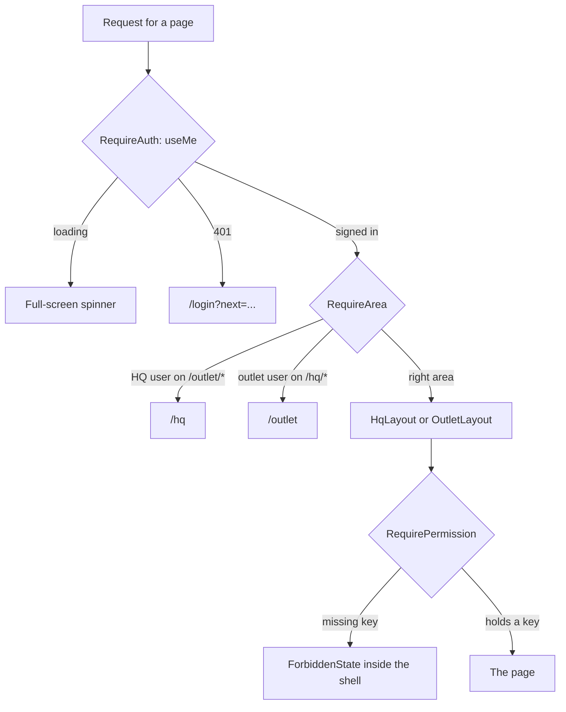
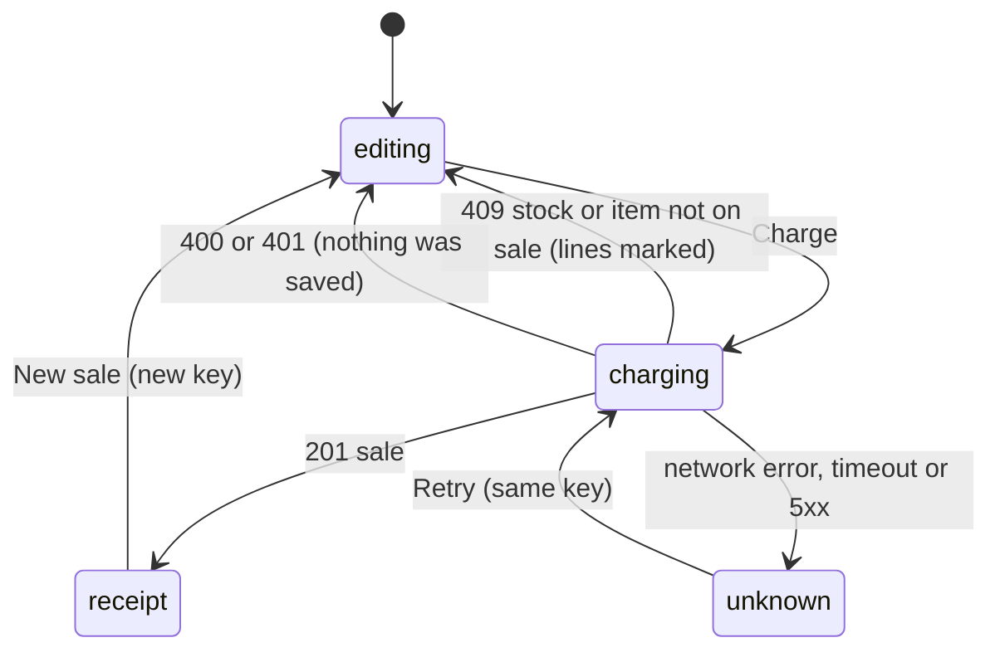

# POS System - Frontend Engineering

> **STATUS: target design, 2026-11-25; each feature's spec confirms or changes its part.**
> Nothing is built yet.
> `.claude/rules/frontend.md` is the short version of this file; the two must agree.
> Choices this file adds beyond the agreed design are marked **(proposed)** and are confirmed at the spec gate of the feature that first needs them.
> The page-by-page design lives in `docs/ui-blueprint.html`.

`web/` is one React app, built by Vite and served by the API container from the same origin as the API.
It has two areas in one build:

- the **HQ console** (`/hq/*`) for HQ users, who manage outlets, the master menu, prices, stock, users and roles, and read reports across outlets;
- the **outlet app** (`/outlet/*`) for outlet users (managers and cashiers), whose main page is the sell screen.

A user belongs to one area only: a user with no outlet is an HQ user, a user with an outlet is an outlet user.

## Stack and why

| Concern | Choice | Why | Rejected |
|---|---|---|---|
| Framework | React 19 + TypeScript (`strict`) | The brief names React; strict TypeScript catches drift between the API contract and the screens | Plain JavaScript: contract drift shows up only at run time |
| Build | Vite | Fast dev server and builds; static output that Express serves from the same container | Next.js: server rendering buys nothing for a signed-in work tool and needs its own server process |
| Routing | React Router v7 (`createBrowserRouter`) | Nested layouts for the HQ console and the outlet app, lazy routes for code splitting, route guards as layout routes | TanStack Router: capable, but no need strong enough to leave the common choice |
| Server state | TanStack Query v5 | Caching, deduplication, invalidation after mutations, loading and error states, retry control; server data has exactly one owner, the query cache | `useEffect` + `fetch`: rebuilds caching badly and races; Redux Toolkit Query: more ceremony for the same job |
| Client state | Zustand | Tiny, no provider tree, selector-based re-renders, easy to persist one slice; holds only state that lives in the browser, such as the cart and the theme preference | React Context for changing state: re-renders every consumer; Redux: boilerplate for little client state |
| URL state | Router search params | Filters, date ranges, the selected tab and the sales cursor survive a reload and can be shared as a link | Zustand: lost on reload, cannot be shared |
| HTTP | One axios instance (`lib/api/client.ts`) | Problem-document parsing and 401 handling in one interceptor | `fetch` scattered across features with copied error handling |
| Forms | react-hook-form + zod (+ `@hookform/resolvers`) | Uncontrolled inputs stay fast; one schema gives the validation and the TypeScript type through `z.infer` | `useState` per field: verbose, and every keystroke re-renders the form |
| UI | shadcn/ui on Tailwind v4 (Radix primitives, Lucide icons) | Components are copied into the repo as our code; Radix gives keyboard and screen-reader support; styling runs through CSS variables, which is how light and dark mode work | MUI or Chakra: a dependency we cannot edit, heavier theming, larger bundles |
| Toasts | sonner | Small, works with shadcn | - |
| Tests | vitest + Testing Library + MSW (Mock Service Worker) | Vite-native runner; tests drive the screen the way a cashier does; MSW fakes the API at the network layer, so the real axios client and interceptors run in every test | Jest: slower to set up with Vite; mocking axios couples tests to implementation |
| Lint | ESLint (typescript-eslint, react-hooks) + `tsc --noEmit` | Hook rules prevent stale-closure bugs; Vite does not type-check | - |

English only; there is no i18n layer.
Strings live in the components that show them.

## State: four kinds, four homes

| Kind | Example | Home |
|---|---|---|
| Server state | the outlet menu with prices and stock, sales, reports, users, roles, who is signed in | TanStack Query |
| URL state | `/hq/reports?from=2026-11-01&to=2026-11-25&outletId=...`, `/hq/outlets/:outletId?tab=stock` | Router search params |
| Form state | the menu item form while someone types | react-hook-form |
| Client state | the cart and its idempotency key, the theme preference, the HQ sidebar collapsed | Zustand |

**Rule:** each piece of data lives in exactly one home.
Server data is never copied into Zustand or into component state.
The cart is the clearest example: it holds only `menuItemId` and `quantity` per line; names, prices and stock are read from the outlet menu query at render time.

**Auth is server state.**
The access token is an HttpOnly cookie that JavaScript cannot read, so there is no token in Zustand, `localStorage` or `sessionStorage`.
"Who am I" is a query, `useMe()` on `GET /api/v1/me`, cached under `queryKeys.me`.
Signing in refetches it; signing out (`POST /api/v1/auth/logout`) clears the whole query cache and the cart store.

**What `me` holds (the API doc owns the exact shape):** user `id`, `name`, `email`, `outlet` (`id`, `code`, `name`, or `null` for an HQ user), the role's name, and `permissions` (permission keys).
The screens read nothing else about the user.

## Folder structure

```
web/
  index.html              sets the theme class before React draws (no flash of the wrong theme)
  vite.config.ts          proxies /api to http://localhost:3000
  src/
    main.tsx              QueryClientProvider -> RouterProvider -> Toaster
    router.tsx            /login; /hq/* (HQ console); /outlet/* (outlet app); /403; 404
    app/
      queryClient.ts      defaults and the global 403 toast
      routes/             RequireAuth, RequireArea (proposed), RequirePermission, access.ts (proposed), homePath.ts (proposed)
      pages/              NotFoundPage, ForbiddenPage, AppErrorPage (proposed)
    components/
      ui/                 shadcn components (our code, edit freely)
      layout/             HqLayout, OutletLayout, PageHeader, AccountMenu
      states/             LoadingState, EmptyState, ErrorState, ForbiddenState (proposed)
      FormField.tsx       label + input + error for react-hook-form (proposed)
    features/
      <area>/             auth, menu, outlets, inventory, sales, reports, roles, users
        api.ts            typed calls through the shared client
        hooks.ts          useQuery / useMutation wrappers
        schemas.ts        zod form schemas and their inferred types
        pages/            one file per route
        components/<page>/  parts of one page
      sales/cartStore.ts  the cart (Zustand, persisted per tab) (proposed)
    lib/
      api/                client.ts (axios on /api), ApiError.ts (problem document -> kind + field errors)
      errors/             describeApiError, handleMutationError
      money.ts            minor units <-> display; the only place money is formatted or parsed
      dates.ts            date and time display, report date ranges (proposed)
      theme.ts            light, dark or system; applies the class on <html> (proposed)
      queryKeys.ts        one key factory for the whole app
    test/                 setup.ts, server.ts (MSW), handlers/, fixtures/, renderWithProviders.tsx (proposed)
```

- Files that export a component are `PascalCase.tsx`; everything else is `camelCase.ts`; tests sit next to the file as `<name>.test.ts(x)`.
- A feature imports another feature only through that feature's `hooks.ts` or `api.ts`, never its `pages/` or `components/`.
- **The HQ console and the outlet app are separate lazy route trees.**
  A cashier's tablet never downloads HQ code, and HQ never downloads the sell screen.
- Components stay presentational: data fetching lives in the feature's `hooks.ts`, and pages wire hooks to components.

## Talking to the API

**One origin, one client.**
The browser calls the relative path `/api/v1/...` on its own origin.
Locally, Vite (port 5173) proxies `/api` to the API on port 3000; deployed, the same container serves both.
There is no CORS request, no `withCredentials` and no auth header: the session cookie goes with every same-origin request on its own.

```ts
export const apiClient = axios.create({
  baseURL: '/api',
  headers: { 'Content-Type': 'application/json' },
})
```

Feature calls use paths like `/v1/outlets/${outletId}/sales`.
Each feature's `api.ts` declares request and response types that mirror the camelCase wire shape, with no key mapping.
`api.ts` returns `response.data`; nothing above it sees axios.

**Errors are `ApiError`, built from problem documents.**
Every error body from the API is an RFC 7807 problem document (`application/problem+json`) with `type`, `title`, `status`, `instance`, `requestId`, and `errors` for validation.
The response interceptor turns every failed response into an `ApiError`:

| Field | Meaning |
|---|---|
| `status` | the HTTP status |
| `kind` | `validation` (400), `unauthorized` (401), `forbidden` (403), `notFound` (404), `conflict` (409), `tooLarge` (413), `rateLimited` (429), `unavailable` (503), `server` (other 5xx), `network` (no response), `unknown` |
| `title`, `detail` | the human message from the problem document |
| `fields` | `errors` as a flat map of field name to message, for example `{ name: 'Required', 'items[0].quantity': 'Must be at least 1' }` |
| `requestId` | shown in error states so a support person can find the log line |

A request with no response (the network dropped, the server is down) also becomes an `ApiError` with kind `network` and no status **(proposed)**, so every caller handles one error type.
Components branch on `kind`, never on raw status codes.

**Field errors land on form inputs.**
The API reports validation errors under the same JSON names the request used, and form field names match those names.
So `handleMutationError` hands `ApiError.fields` to react-hook-form's `setError` field by field, and the message appears under the right input.
A field key the form does not have (for example a nested key the form flattened) falls back to a toast with the problem's title.

**401: the session ended.**
A 401 from any call except `GET /v1/me` and `POST /v1/auth/login` invalidates the `me` query.
`useMe()` then fails with `unauthorized`, and `RequireAuth` sends the person to `/login?next=<where they were>`.
There are no refresh tokens: when the access token expires (`ACCESS_TOKEN_TTL`, one hour by default) the next call gets 401 and the person signs in again.
The cart survives this, because it is persisted in the tab (see the sell screen below).

**403: not allowed.**
The query cache and mutation cache have one `onError` that toasts "You don't have access to do that" for kind `forbidden`.
Pages do not handle 403 themselves, and a 403 never signs anyone out.
A page the user cannot open is stopped earlier, by `RequirePermission`.

**Query client defaults:**

| Setting | Value | Why |
|---|---|---|
| `staleTime` | 30 s | lists stay fresh enough without refetching on every mount |
| `gcTime` | 5 min | bounds memory in a tab that stays open all day |
| query `retry` | up to 2 times, only for kind `network` or `unavailable`, with backoff **(proposed)** | outlet Wi-Fi drops for a moment; a 4xx never succeeds on retry |
| mutation `retry` | never | a write is retried only by a person, and the sale retry reuses its idempotency key |
| `refetchOnWindowFocus` | off | a POS tab is focused all day; refetches follow writes instead |
| `refetchOnReconnect` | on | after the network returns, the menu and stock refresh |

**Query keys and invalidation.**
`lib/queryKeys.ts` is the only place keys are built, so invalidation is precise and typo-free.
Mutations invalidate in `onSuccess`; they never patch the cache by hand.

| Mutation | Invalidates |
|---|---|
| create a sale | `outletMenu(outletId)`, `inventory(outletId)`, `sales.list(outletId)`, `reports` |
| stock movement | `inventory(outletId)`, `outletMenu(outletId)` |
| assign, change price or availability, unassign | `outletMenu(outletId)`, `inventory(outletId)` |
| create or edit a master item | `menuItems`, every `outletMenu` |
| create or edit an outlet | `outlets` |
| create, edit or delete a role | `roles`; also `me` when it is the signed-in user's role |
| create or edit a user | `users`; also `me` when it is the signed-in user |

Permissions live in the access token, so a role change reaches a signed-in user only at their next sign-in.
Until then the screens may still show a button the API refuses; the 403 toast covers that gap.

## Access in the UI

The API enforces every rule.
The UI follows the same rules only so people never see what they cannot use.

**`useMe()`** is the single source of who the user is.
`useHasPermission(keys)` is true when the user holds at least one of the keys, matching `requirePermission` on the API.
`Permission` is an `as const` object in `features/auth/permissions.ts` that copies the catalog in `api/src/modules/roles/permission.ts` key for key.

**Route guards, outermost first:**



- **`RequireAuth`** renders a spinner while `me` loads, sends a 401 to `/login?next=...`, and throws any other error to the router's error page.
- **`RequireArea`** **(proposed)** sends an HQ user who opens `/outlet/*` to `/hq`, and an outlet user who opens `/hq/*` to `/outlet`.
  `.claude/rules/frontend.md` names only `RequireAuth` and `RequirePermission`; this third guard keeps the area check out of every page.
- **`RequirePermission`** wraps each page's route with the keys from `app/routes/access.ts` and shows the forbidden state inside the shell, so the menu stays usable.

**`access.ts` (proposed)** maps each page to the keys that open it and the keys behind each action, in one object that the router, the menus and the pages all read:

```ts
export const access = {
  hqOverview: { view: [Permission.ReportsRead] },
  outlets: { view: OUTLET_READERS, create: [Permission.OutletsManage] },
  outletDetail: {
    view: OUTLET_READERS,
    edit: [Permission.OutletsManage],
    menuTab: [Permission.MenuAssign],
    stockTab: [Permission.InventoryManage],
    salesTab: [Permission.SalesRead],
  },
  sell: { view: [Permission.SalesCreate] },
  outletStock: { view: [Permission.InventoryRead], adjust: [Permission.InventoryAdjust] },
  // ...one entry per page
} as const satisfies Record<string, PageAccess>
```

`OUTLET_READERS` is `outlets.manage`, `menu.assign` and `inventory.manage`, the keys that may read `GET /outlets` and `GET /outlets/:outletId`.
The "Assign item" dialog lists master items through `GET /menu-items`, which `menu.assign` may read as well as `menu.manage`.
The full page-to-permission table is in `docs/ui-blueprint.html`.

**Where people land.**
`/` and the end of sign-in send an HQ user to `/hq` and an outlet user to `/outlet`.
If the user cannot open that area's first page (an HQ role without `reports.read`, an outlet role without `sales.create`), the index route redirects to the first menu entry they can open **(proposed)**.
A user who can open no page at all lands on `/403`, which explains that their role has no access and offers "Sign out".
After sign-in, `next` is honoured only if it starts with the user's own area (`/hq` or `/outlet`), so it can never point to another site or the wrong area.

**Hide, do not disable.**
Menu entries, tabs and buttons the user cannot use are not rendered.
A disabled control is kept only for a state the user can change (an empty cart disables "Charge").
A page that is read-only for this user shows its data without edit controls rather than as a disabled form.

## The sell screen

The sell screen (`/outlet`) is where the system earns its keep.
A cashier uses it hundreds of times a shift, on a tablet or a laptop, often with a queue waiting.
It must be fast, hard to misuse, and correct when the network is not.

### Data

- **Menu:** `GET /outlets/:outletId/menu` through `useOutletMenu(outletId)`: the assigned items with effective price and stock.
  The grid shows items that are active and available; an item with stock 0 shows "Sold out" and cannot be added.
- **Outlet:** `outletId` and the outlet code come from `me.outlet`; the sell screen never asks.
- `staleTime` for the outlet menu is 5 minutes **(proposed)**; it refreshes after each sale, on reconnect, and when the cashier taps "Refresh".
  Stock shown on the tiles is a hint for the cashier; the sale transaction on the server is the truth.

### Cart state

The cart is a Zustand store in `features/sales/cartStore.ts` **(proposed)**:

```ts
interface CartState {
  lines: { menuItemId: string; quantity: number }[]
  idempotencyKey: string
  status: 'editing' | 'charging' | 'unknown'
  problemLines: Record<string, number>
}
```

- Lines hold only IDs and quantities; prices and names come from the menu query, so a price change at HQ shows on the next menu refresh.
- Adding an item already in the cart increases its quantity; the cart never holds the same item twice.
- Quantity is capped at the stock the menu reports, so the cashier sees "Only 3 left" before charging rather than a 409 after.
- The cart total on screen is a preview, summed in integer minor units; the receipt shows the total the server computed.
- **Persisted per tab:** the store is saved to `sessionStorage` under a key built from the user ID and outlet ID **(proposed)**.
  A reload, a crash of the page, or a sign-in after a 401 brings the same cart and the same idempotency key back.
  `sessionStorage` is per tab, so two tabs never share one cart; it holds no token, only line IDs, quantities and the key.
  Sign-out and a sign-in by a different user clear it.

### Idempotency key, one per cart, kept across retries

- The key is a UUID from `crypto.randomUUID()`, made when the cart is started (the first item added after the previous sale).
- Every attempt to charge this cart sends the same key in the `Idempotency-Key` header of `POST /outlets/:outletId/sales`.
- The key changes only when a sale succeeds (the cart empties and a new cart starts) or when the cashier clears the cart while its status is `editing`.
- If the API already holds a sale with this key, it returns that sale unchanged, so a retry after a lost response never sells twice.

### Charging: no optimistic UI

A sale is shown as done only when the server says so.
The receipt number, the frozen prices and the total all come from the server, and stock can run out between tap and commit, so there is nothing safe to fake.
Cart edits, by contrast, are local and instant.



| Outcome | What the cashier sees | Cart |
|---|---|---|
| **201** | The receipt panel: `DHK01-000123`, lines, total, time; "New sale" and "Print" | Cleared; a new key is made when the next cart starts |
| **409 not enough stock** | A toast with the API's message; the menu refetches; each line whose quantity is above the fresh stock is marked "Only N left" or "Sold out", with a one-tap "Set to N" | Kept with the same key, editable; nothing was saved, because the sale transaction rolled back |
| **409 item not on sale** | An item was unassigned, marked unavailable or made inactive since the menu loaded: a toast with the API's message; the menu refetches and each line no longer on the menu is marked "No longer on sale" with "Remove" | Kept with the same key, editable; nothing was saved |
| **400 validation** | A toast with the message | Kept, editable |
| **401** | Sent to sign in; back on the sell screen afterwards | Kept in the tab, same key; the API rejected the request before the sale began |
| **403** | The global toast | Kept |
| **network, timeout or 5xx** | "We couldn't confirm the sale. Retry before doing anything else." with one primary button, "Retry" | **Locked** in status `unknown`: no edits until a retry gets a definite answer, because the first attempt may have been saved |

**Why the cart locks on an unknown outcome (proposed).**
If the first request was saved and the cashier edits the cart, a retry with the same key returns the original sale, not the edited one.
If the cashier instead cleared the cart and started again with a new key, the customer could be charged twice.
Locking the cart until "Retry" gets an answer avoids both.
The cashier can still choose "Discard cart" from a menu, behind a confirmation that warns the sale may already be recorded and points to the sales list.

A double tap on "Charge" sends one request: the button is disabled while the status is `charging`, and the mutation is guarded by the status, not by the button alone.

### The 409 detail

The API's 409 for a short line (`ErrInsufficientStock`) or an item no longer on sale (`ErrItemNotSellable`) names the item in its message.
The screen does not parse that message: it refetches the outlet menu and compares each cart line with the fresh menu and stock, which marks every short or removed line at once, not only the first one the server hit.
If the API later adds the item's ID to the problem document as an extension member **(proposed)**, the screen also scrolls to that line; nothing else depends on it.

### Receipt

- Receipt numbers are shown as `<outlet code>-<number padded to 6 digits>`, for example `DHK01-000123`, by `formatReceiptNumber(code, number)` in `features/sales/format.ts` **(proposed)**.
  The API stores and sends the integer.
- "Print" uses the browser's print dialog with a print stylesheet sized for an 80 mm receipt printer **(proposed)**; printer setup is out of scope.
- The same receipt view is the sale detail page (`/outlet/sales/:saleId`), so a receipt can be reprinted later.

### Input and speed

- Item tiles and the "Charge" button are large touch targets (see performance rules).
- A search box filters the grid by name or SKU as the cashier types; on a laptop, `/` focuses it and `Enter` adds the single match **(proposed)**.
- Category chips filter the grid; "All" is the default; the chosen category is kept in the URL (`?category=`).
- Each tile and cart row re-renders only when its own data changes (Zustand selectors per line, memoized tiles).

## Money

Money arrives from the API as an integer in minor units (`totalMinor`, `basePriceMinor`, `priceOverrideMinor`, `unitPriceMinor`) and is a `number` in TypeScript.
`lib/money.ts` is the only place money is formatted or parsed.

```ts
formatMoney(minor: number): string          // 125050 -> "৳1,250.50"
parseMoney(input: string): number | null    // "1,250.5" -> 125050; null when not a valid amount
```

- **One currency for the company (proposed):** the schema stores no currency column, so the currency is configured once, as `CURRENCY` in `money.ts` (default `BDT`), with one locale and two minor digits.
  The default is the taka, shown with the narrow symbol, because the seed's outlet codes are Dhaka outlets; changing it is a one-line change.
- One `Intl.NumberFormat` instance is created once and reused.
- Amounts always show two decimals, with tabular figures in tables and totals so columns line up.
- **Never float arithmetic on money.**
  Sums and line totals are integer additions and multiplications of minor units.
  `parseMoney` reads the major and minor parts from the string; it never multiplies a float by 100.
- Price inputs take major units as text ("1250.50"); the zod schema transforms them with `parseMoney` into `basePriceMinor` before the request is built.
- A cleared price override is sent as `null`, never as 0; 0 is a real price.

## Dates and times

- The API sends UTC ISO 8601 strings; `lib/dates.ts` **(proposed)** shows them in the browser's time zone, which for an outlet device is the outlet's time zone.
- Format: `25 Nov 2026, 4:15 pm` in lists and on receipts; `4:15 pm` for today's sales.
- Report ranges are picked as local calendar days and sent as `from` and `to` ISO timestamps covering those days (start of `from` day, start of the day after `to`).
  The presets are Today, Yesterday, Last 7 days, Last 30 days and Custom.

## Forms

- react-hook-form with `zodResolver`; each schema lives in the feature's `schemas.ts`, and its inferred type is the form's type.
- Field names are the API's JSON names (`basePriceMinor` is the one exception: the form field is `basePrice` text, converted in the schema).
- `FormField` renders label, input, hint and error together; every input has a visible label.
- The submit button shows a spinner and is disabled while the mutation runs, so a double click sends one request.
- Server errors pass through `handleMutationError`: field errors onto inputs, a 409 as a toast plus a refetch, anything else as a toast with the problem's title.
- Edit forms that load a record take it through react-hook-form's `values` option and are keyed by the record's ID (`key={item.id}`), so a save or refetch updates the form without remounting it and without a `useEffect` copying data in.
- Leaving an edit page with unsaved changes asks for confirmation (React Router's `useBlocker`) **(proposed)**.
- Schemas mirror the API's rules for a fast answer (required fields, SKU and code shape, non-negative prices); the API stays the authority and its message wins.

## Loading, empty, error and forbidden states

Every page designs all four, not only the happy path.

| State | How it looks | Rule |
|---|---|---|
| Loading | Skeletons in the page's real shape (table rows, tiles, KPI tiles); a spinner only inside buttons | Shown only after 150 ms, so fast loads do not flash **(proposed)** |
| Empty | One sentence saying what belongs here and the button that adds it, if the user may add | "No sales yet today" is not an error |
| Error | What failed, the `requestId` in small type, and "Try again" (refetch) | A failed refetch keeps showing the old data with a small banner instead of replacing the page |
| Forbidden | Inside the shell: "Your role doesn't include this page", with a link to the area's home | Never a sign-out; the menu stays usable |
| Not found | A record that no longer exists (404) shows "This item doesn't exist or was removed" and a back link | The 404 route handles unknown paths |

`components/states/` holds one component per state **(proposed)**, so every page looks the same when things fail.
The router's `errorElement` (`AppErrorPage`) catches render crashes and offers "Reload".

**Offline banner (proposed):** when the browser reports it is offline, a thin banner says so across the top of the outlet app.
Charging is still allowed: the request will fail as a network error and follow the unknown-outcome path above.
Selling while offline is not in this build; the architecture document describes how it would work.

## Testing

- **vitest** with **Testing Library** and **MSW**; tests sit next to the file they test.
- `test/renderWithProviders.tsx` **(proposed)** renders with a fresh `QueryClient` (retries off), a memory router at a given path, and a signed-in user from fixtures.
- MSW handlers in `test/handlers/` mirror the API per feature and return typed fixtures; a test overrides one handler to return a problem document.
  The real axios client and interceptors run in every test; axios is never mocked.
- Tests query by role and label (`getByRole('button', { name: 'Charge' })`), never by class or test ID unless there is no accessible name.

**Required tests**

| Area | Tests |
|---|---|
| Sell screen | add, increase, decrease, remove; quantity capped at stock; charge sends `{ items: [{ menuItemId, quantity }] }` with an `Idempotency-Key`; a 201 shows the receipt number `DHK01-000123` and clears the cart |
| Sell screen, failures | a 409 marks the short lines and keeps the key; a network failure locks the cart and "Retry" sends the **same** key (asserted from the request MSW received); a double tap sends one request; a reload restores the cart and key |
| `lib/money.ts` | formatting, parsing edge cases (`"0"`, `"0.5"`, `"1,250.50"`, `"-1"`, `"1.234"`, empty), no float drift |
| `ApiError` | every status maps to its kind; `errors` becomes `fields`; a non-JSON or empty body still gives an `ApiError` |
| Access | landing per user type; an outlet user on `/hq` is redirected; a missing key shows the forbidden state; hidden menu entries and buttons |
| Auth | 401 on any call sends the user to login with `next`; `next` from the other area is ignored; sign-out clears the cache and the cart |
| Forms | a server 400 puts each message under its input; a 409 on unassign offers "Mark unavailable" |

End-to-end tests in a real browser against `docker compose up` are an open question (see below).

## Quality bar

- `npm run lint`, `npm run typecheck` and `npm test` pass, and `npm run build` succeeds, before a change is handed over.
- Every UI change is checked in a browser, in light and dark mode, at tablet and laptop widths.
- No `any`, no `enum` (use `as const` objects with a derived union), no `eslint-disable` without a one-line reason.
- Independent async work uses `Promise.all`.
- No colour, size or radius values inside components: only the theme's tokens through Tailwind classes.
- Accessibility: Radix primitives keep keyboard and screen-reader support; every input has a label; focus is visible; colour is never the only signal (a "Sold out" tile also says so); text contrast meets WCAG AA in both modes.
- Every value in `import.meta.env` is public; the frontend holds no secrets.

## Performance rules

A POS tab stays open for a whole shift, on a mid-range tablet or an ordinary laptop, often on shared outlet Wi-Fi.
What matters is that every tap answers at once and that the tab is as fast at closing time as at opening.
A break of these rules is a must-fix in review.

**Response to taps**
- Adding to the cart, changing a quantity and switching category never wait on the network; they update local state and render in under 100 ms on a mid-range tablet.
- The sell screen makes one request on load (the outlet menu) and one per sale; nothing polls.
- Item tiles and cart lines are memoized and read the store through selectors, so tapping one tile re-renders that tile and the cart, not the whole grid.

**Touch**
- Every interactive element in the outlet app is at least 44 by 44 CSS pixels; item tiles are at least 96 pixels tall and "Charge" at least 56 pixels tall **(proposed)**.
- `touch-action: manipulation` on the outlet app removes the double-tap zoom delay; tiles prevent accidental text selection.
- Nothing depends on hover; every action has a visible control.

**Long-running tabs**
- `gcTime` bounds the cache; the sales list uses an infinite query with `maxPages` so scrolling through a day's sales does not grow memory without limit **(proposed)**.
- No `setInterval` without cleanup; any timer lives in a hook that clears it on unmount.
- The HQ overview may refetch every 60 seconds while visible (`refetchIntervalInBackground: false`) **(proposed)**; outlet screens do not poll.
- **New version after a deploy (proposed):** `index.html` is served with `Cache-Control: no-cache` and hashed assets as immutable, and the app compares its build version with the server's on each navigation; when they differ it shows "Update ready" and reloads only when the cart is empty.

**Bundle**
- The HQ console and the outlet app are separate lazy route trees; nothing under an HQ-only page is imported by outlet code.
- The outlet app's first load stays under 200 KB of gzipped JavaScript **(proposed)**, checked in CI with a bundle size check chosen in the foundation spec.
- Import Lucide icons and Radix parts one by one, never through a barrel that pulls in everything.
- Charts in HQ reports are plain HTML and CSS bars, not a chart library **(proposed)**: ten outlets and a top-five list do not need one.
- Adding a dependency to the outlet app needs its gzipped size and a reason at the gate.

**Fonts and images**
- The system font stack; no web font, so the first paint never waits on a font download, even on a slow connection **(proposed)**.
- Menu items have no images in this build; tiles are text with a category colour.

**Lists**
- Lists that grow (sales) use the API's keyset cursor with "Load more"; never offset.
- Short master lists (outlets, menu items, users, roles) load whole and filter on the client; a list rendered above 200 rows is virtualized.

## Open questions

- [ ] **Session length for cashiers.**
  With a one-hour token and no refresh, a cashier signs in again every hour.
  Options: a longer TTL for outlet roles, or a refresh token; until then, the persisted cart keeps a sign-in from losing a sale in progress.
- [ ] **Outlet and role choices on the user form.**
  The user form's "works at" and role fields, and the users filters, need the outlet and role lists, but `GET /outlets` accepts only `outlets.manage`, `menu.assign` or `inventory.manage`, and `GET /roles` only `roles.manage`, so an HQ role that holds `users.manage` alone cannot fill them.
  Options: add `users.manage` to the readers of `GET /outlets` and `GET /roles`, or require those keys next to `users.manage` for the users pages.
- [ ] **Stock history.**
  The API has no endpoint to list `stock_movements`, so the stock pages show current quantities only.
- [ ] **Finding a sale.**
  The sales list has only a cursor; searching by receipt number or filtering by date needs query parameters the API does not list yet.
- [ ] **Change due.**
  The sale records no payment; a "cash received" field that shows change on screen, without sending it, would help cashiers.
- [ ] **Shared types.**
  Request and response types are written twice, in the API's DTOs and the web's `api.ts`.
  Options: a small shared package, or types generated from an OpenAPI document; both change the repo layout.
- [ ] **End-to-end tests.**
  Playwright against `docker compose up` for sign-in, a sale, and the 409 path; a new dependency, raised at the gate.
- [ ] **Error tracking** for the frontend (which tool, if any).
